# Software Design Description (SDD)
## Zambia National ETD Aggregator (NETD v2)

| Item | Value |
|---|---|
| Document | SDD, structured per IEEE 1016-2009 (design viewpoints) |
| Version | 0.26 |
| Date | November 1, 2026 |
| Owner | Dr Lighton Phiri, DataLab Research Group, University of Zambia |
| Related | `docs/SRS.md` (requirement IDs referenced below) |

### Revision history
| Version | Date | Changes |
|---|---|---|
| 0.1 | October 30, 2026 | Initial design: harvester, raw/canonical stores, crosswalk, enrichers, Blacklight portal, deployment |
| 0.2 | October 30, 2026 | Discipline/degree derivation; Solr analysers; URL-safe record ids; HTTPS |
| 0.24 | November 1, 2026 | Fields of study (FR-54 to FR-57): model `openalex-fos` (`netd/ml/models/fieldofstudy.py`, data in `netd/ml/models/data/`), batch prediction in `predict.run`, per-field display thresholds in the overlay, Solr fields `fos_domain_ssim`, `fos_field_ssim`, `fos_subfield_ssim`, `fos_ssm`, `fos_tsim`, facets and record page, API `fields_of_study` (1.2.0), OAI-PMH subject scheme, training scripts in `harvester/tools/` |
| 0.26 | November 2, 2026 | Deployment view: Ubuntu 26.04.1 LTS (kernel 7.0), MySQL 8.4, PHP 8.5 for the co-hosted sites; NETD unchanged in design: Ruby 3.3.6 rebuilt against OpenSSL 3.5, venv recreated; `netd-backup.sh` waits for Solr after a reboot; `deploy/ops/ocr-resume.sh` and `deploy/ops/upgrade/` (upgrade scripts) added |
| 0.25 | November 1, 2026 | Repository watch (FR-58): `netd/repocheck.py`, `netd.cli check-repositories`, result in `/opt/netd/logs/repository-check.json`, run by `netd-weekly.service` (ExecStartPre) before the weekly email, admin dashboard section via `Harvester.repository_check`; registry keys `oai`, `etd_sets`, `checked`, `note` and status `no-etds-yet` (API 1.3.0); `/contribute` page (FR-59); metadata quality (FR-28): `netd/quality.py` (`netd.cli quality-report`, also after `run` and `reprocess`) writes `logs/quality.json`, read by `QualityReport`; public `QualityController` at `/quality` shows overall figures only, `Admin::QualityController` at `/admin/quality` the per-institution breakdown (both with `.csv`, `.json`); date added (FR-60): table `first_seen` (written once in `Store.put_record`; backfilled with each source's first harvest), Solr `added_dtsi`, sort `added`, Atom/RSS entry templates `catalog/_document.{atom,rss}.builder` dated by `added_dtsi`, results tool `follow_search_link`, `FollowController` at `/follow`, API `added_at` / `sort=added` (1.4.0) |
| 0.23 | November 1, 2026 | Metadata filling (FR-14, FR-48 to FR-53): package `netd.ml` (text cache with OCR, prediction cache, overlay, predict runner, evaluation, baseline model `titlepage-rules`); overlay step in processing; `derived_ssm` in Solr; record-page badges; API `derived` (1.1.0); admin record corrections and degree-level review; `netd.cli reprocess`; store in WAL mode (NFR-14); backup reads the store as `netd`; OCR packages on the server; documented walkthrough notebook `notebooks/netd26-03-ml_metadata_filling-walkthrough.ipynb` (runs every step on a sample from the public API, locally or in Colab) |
| 0.22 | November 1, 2026 | Postgraduate scope (FR-47): `scope.degree_levels` and per-source `exclude_records` in `sources.yml`; `cli.exclusion()` in processing; table `excluded`; `index.ids()` so indexing removes from Solr every document the store no longer holds; Postgraduate Diploma in `DEGREE_PAT`, repository-supplied levels normalised; level set `level:postgraduate-diploma` and API level `postgraduate_diploma` |
| 0.21 | November 1, 2026 | REST API v1 (§5.3, EI-6, FR-42 to FR-46): `Api::V1::` controllers on `ActionController::API`, `ApiRecord` representation, OpenAPI 3 specification `public/api/v1/openapi.yaml`, interactive reference `/developers/api`, export files in `portal/tmp/api_export/` |
| 0.20 | November 1, 2026 | Admin panel (§5.2, FR-36 to FR-41, NFR-13): `Admin::` controllers, `AdminAuthentication`, `Harvester` model, portal tables `users`, `sessions`, `admin_events` and problem-report resolution columns (§4.1); `harvester/sources.local.yml`; shared `run.lock`; `netd-user.sh` account management; backups include CSV files |
| 0.19 | November 1, 2026 | `netd.csvload` CSV loader (FR-10), `netd.cli csv-check`, template `portal/public/netd-etd-template.csv`, `deploy.sh` creates `harvester/uploads/` |
| 0.18 | October 31, 2026 | OAI-PMH data provider (§5.1, EI-4): `OaiController` at `/oai`, read from Solr only; `records.updated_at` now changes only when a record's content changes and is indexed as `updated_dtsi` (datestamp); `netd.cli check` asserts that `Identify` answers; conformance test `tests/oai_conformance.py` |
| 0.17 | October 31, 2026 | Operations (§8): `netd.cli check`; `deploy/ops/` backup, Drive upload, alert and probe scripts; `netd-backup`, `netd-probe`, `netd-weekly` timers and `netd-alert@` template with `OnFailure=` on every unit |
| 0.16 | October 31, 2026 | `PagesController#faq/#developers/#credits`; footer partial; `credits` section in `publications.yml`; ZAMREN logo in `public/images/` |
| 0.10 | October 31, 2026 | Record page `catalog/show.html.erb` + `RecordHelper`; index gains `files_ssm` (name, type, size, URL per file) and `rights_ssm` |
| 0.9 | October 31, 2026 | `NetdHeaderComponent` (header), landing page redesign, new theme `netd.css` modelled on Academic Commons |
| 0.8 | October 31, 2026 | Served at the site root; Apache sites managed in `deploy/apache` (HTTP→HTTPS, redirects for `/beta` and old portal paths, `/znrp` and `/ojs` excluded); old Tomcat portal no longer proxied |
| 0.5 | October 31, 2026 | `bitstreams` table; file links from OAI `ore`, DSpace REST bundles and METS; `pdf_url`, `full_text_ssim` |
| 0.4 | October 31, 2026 | DSpace 6 METS loader (`netd.mets`); HTTPS proxy passes X-Forwarded-Proto (fixes record clicks) |
| 0.3 | October 31, 2026 | DSpace REST loader (`netd.rest`); institution registry, zero-count Institution facet and home page; About page from `publications.yml` |

---

## 1. Introduction
### 1.1 Purpose and scope
This SDD describes how NETD v2 meets the SRS: the system's context, components, information model, interfaces, interaction, state, deployment, and the main design decisions. It covers release 0.22.

### 1.2 Stakeholders and concerns
| Stakeholder | Concerns | Viewpoints |
|---|---|---|
| DataLab developers | Structure, extension points, deployment | Composition, Interface, Deployment |
| Data scientists | Where ML models plug in; provenance | Information, Interaction (§6.2) |
| Portal administrator | Operation, resource use, recovery | Deployment, State |
| Project lead / reviewers | Alignment with SA NETD and NDLTD; trade-offs | Context, Rationale |

---

## 2. Context viewpoint

### 2.1 Use cases
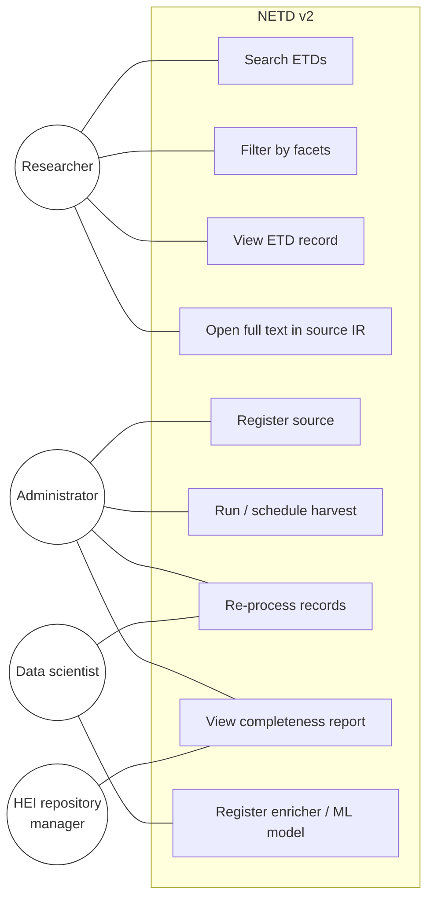

### 2.2 System context
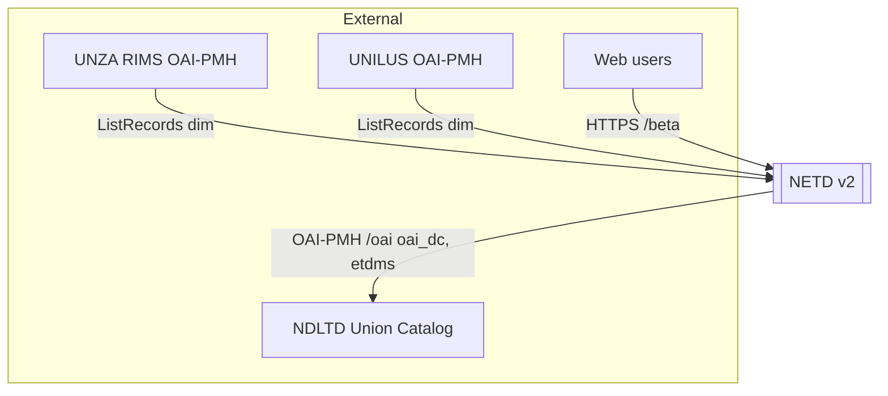

---

## 3. Composition viewpoint (components)

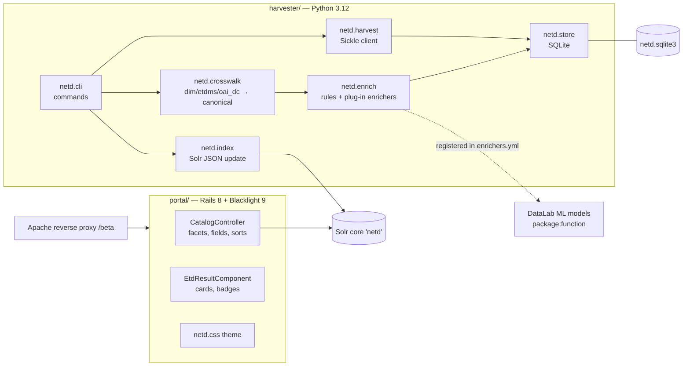

| Component | Responsibility | SRS |
|---|---|---|
| `netd.harvest` | OAI-PMH client, format choice, sets, incremental runs, retries, run log | EI-1, FR-2–FR-8 |
| `netd.store` | Raw layer, set names, canonical layer, harvest runs | FR-7, FR-11 |
| `netd.crosswalk` | Flattening of `dim`/`etdms`/`oai_dc`; field mapping; set-based and text-based derivation; provenance | FR-12–FR-15 |
| `netd.enrich` | Built-in rules; loading and running external enrichers; confidence → facetable | FR-16–FR-18 |
| `netd.index` | Canonical → Solr document (Blacklight dynamic-field names) | FR-21 |
| `netd.rest` | Fallback loader: DSpace 7 REST API items → `dim` XML in the raw layer (set specs from collection and parent community) | FR-10 |
| file links (all loaders) | OAI-PMH sources: second `ListRecords` pass in `ore`, taking `ore:aggregates` links (DSpace 7 UI download links normalised to `/server/api/core/bitstreams/<uuid>/content` on the repository host); REST: item ORIGINAL bundle; METS: CONTENT file group. Stored in table `bitstreams`; crosswalk sets `pdf_url` (largest PDF first) or `file_url` | FR-32 |
| `netd.mets` | Fallback loader: DSpace 6 XMLUI collection browse pages → item handles → `/metadata/handle/<h>/mets.xml` → embedded `dim` stored in the raw layer | FR-10 |
| `netd.csvload` | Fallback loader for HEIs without a repository: CSV from `csv_url` (fetched each run, at most 50 MB) or `csv_path` (file or folder; default `/opt/netd/harvester/uploads/<id>/`). Delimiter sniffed (`,` `;` tab); UTF-8 or cp1252. Valid rows become `dim` XML in the raw layer with oai_id `csv:<id>:<identifier>`; `pdf_url` becomes a bitstream; rows missing from the CSV are marked deleted; invalid or duplicate rows are skipped and logged. A source with no valid rows fails the run instead of deleting its records | FR-10 |
| `netd.cli` | `harvest`, `process`, `index`, `run`, `report` | FR-9, FR-27 |
| `institutions.yml` + `InstitutionRegistry` | All HEA-accredited postgraduate HEIs with harvest status; for those not yet harvested, the repository's `oai` endpoint, `etd_sets`, last manual check and a note | FR-29 |
| `netd/quality.py` (`quality-report`) | Per institution and element, share of records by origin of the value (provenance `harvested`/`rule` → repository element; `set`/`text` → elsewhere in the repository; `model`/`corrected` → portal; none → missing); ETD-MS compliance at source; advice for elements below 50% at source; `logs/quality.json` for `/quality` | FR-28 |
| `netd/repocheck.py` (`check-repositories`) | Weekly check of not-yet-harvested repositories: page status, OAI-PMH Identify, `ListIdentifiers` counts overall and per ETD set (one request at a time, 30–90 s timeouts); writes `logs/repository-check.json` with changes since the previous run; read by the admin dashboard and `netd-alert.py --weekly` | FR-58 |
| `InstitutionFacetComponent` | Institution facet listing registry institutions with no records as 0 (hidden once an institution is selected) | FR-29 |
| `NetdHeaderComponent` | Group bar, wordmark, search box, link row (About, Explore, Master's, PhD) | EI-5 |
| Home page (`catalog/_home_text`) | Intro line; Explore Master's/PhD cards; stats at a glance; contributing institutions with the HEA list behind a toggle | FR-26, FR-30, FR-33 |
| `PagesController#about` + `publications.yml` | Project details and publications; `deploy/gen_publications_md.py` writes `PUBLICATIONS.md` from the same file | FR-31 |
| Blacklight portal | Search UI, facets, sorting, record pages, JSON API | FR-20–FR-24, EI-3, EI-5 |
| Solr core `netd` | Blacklight schema (ICU analysers replaced by built-in ASCII folding, as the slim Solr distribution lacks the ICU module); `qf` tuned to ETD fields | NFR-1 |

---

## 4. Information viewpoint

### 4.1 Persistent data (SQLite)
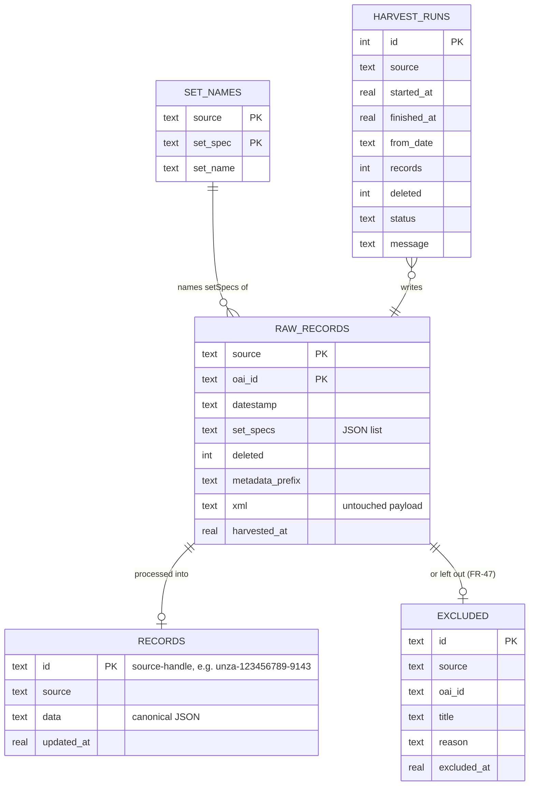

Portal database (`portal/storage/production.sqlite3`, Rails migrations), besides Blacklight's `searches` and `bookmarks`:
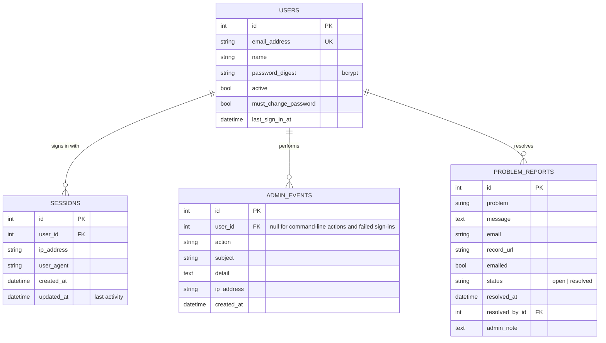

Postgraduate scope (FR-47). After the crosswalk and the enrichers, `cli.exclusion()` decides whether a record enters `records`: it is left out if its source lists its `oai_id` under `exclude_records` (with a reason), or if its `degree_level` is identified and not in `scope.degree_levels` (default Doctoral, Masters, Postgraduate Diploma). Records of unknown level are kept. Excluded records go to `excluded` with the reason (rebuilt for a source on every processing run) and are shown by `netd.cli report` and on the admin source page; `raw_records` is untouched, so an exclusion is undone by removing it from `sources.yml`. Indexing then deletes from Solr every document of the source that `records` no longer holds (`index.ids()`), which also covers records deleted at the source. Levels come from the repository's own value, normalised, or from `DEGREE_PAT` over the degree name, type, description and collection names, postgraduate levels first; the ML models (FR-14) will fill the unknown levels later through the same field.

#### 4.1.1 Metadata filling (FR-14, FR-48 to FR-53)
Package `harvester/netd/ml`. Models never write to `records`; they write to a cache that processing reads.

```mermaid
flowchart LR
  R[(records)] -->|pdf_url, files| T[textcache<br/>extract-text, ocr-text]
  T -->|first pages, front matter first| PT[(pdf_text)]
  PT --> P[predict runner]
  R -->|harvested values only| P
  M[models/titlepage.py<br/>NAME, VERSION, FIELDS, USES,<br/>prepare(texts), predict(meta, text)] --> P
  C[Colab / elsewhere] -->|JSON Lines| L[load-predictions]
  P --> PR[(predictions)]
  L --> PR
  A[Admin panel] -->|netd.cli correct| CO[(corrections)]
  PR --> O[overlay.apply]
  CO --> O
  O -->|after enrichers, before FR-47| X[cli.exclusion]
  O --> LR[(level_review)]
  X --> R
```

- **Text cache** (`textcache.py`, FR-48). `front_urls()` orders a record's PDFs so files named cover/title come first, then other front-matter names (prelim, abstract, declaration, approval, certificate), then the rest; with no front-matter file only the first PDF is read; at most 3. `extract-text` downloads each file (≤ 60 MB, 2 threads fetching, SQLite written from the main thread only), keeps the first 8 pages with `pypdf`, and stores status `ok`, `no_text` (no text layer), `too_large` or `error`. `ocr-text` takes the `no_text` rows one at a time: `pdftoppm` at 200 dpi, greyscale, first 5 pages, then `tesseract` (English), both under `nice 19`; status `ocr` or `ocr_failed`. The `url` column holds the files read, so a change in the record's files makes it pending again. Both commands run under `run.lock` in batches (500 PDFs, 50 OCRs), so a nightly harvest waits at most one batch.
- **Prediction cache** (`cache.py`, FR-49). `predictions` is keyed by (record, field, model) and holds version, value list, confidence, input hash and evidence. `predict.run()` builds each record's input from its PDF text and the harvested values of the fields the model `USES` (values with provenance `model:` or `corrected:` are removed, so models never learn from each other), hashes it with the model version, and calls `predict()` only when the hash changed; fields a model covers but finds nothing for are stored as `[]`, so they are not recomputed. `prepare(texts)` gives a model corpus-level state (the baseline's word counts). `load-predictions` accepts JSON Lines from other environments.
- **Overlay** (`overlay.py`, FR-14, FR-50 to FR-52), called by `do_process` after the enrichers and before `cli.exclusion()`. A record with neither predictions nor corrections is returned untouched (byte-identical, so OAI-PMH datestamps do not move). Otherwise, for each predicted field that is empty and not corrected, the best prediction is applied if its confidence ≥ `ml.show_threshold`; it sets the value, `provenance[field] = model:<name>-<version>`, `confidence[field]` and `derived[field]`. A predicted level below postgraduate is applied only at ≥ `ml.level_auto_exclude` (FR-47 then excludes the record, naming the model); between `ml.level_review_min` and that it goes to `level_review` instead. Corrections then overwrite (or clear) fields with `provenance = corrected:<e-mail>`. A `_scope` correction is returned to `cli.exclusion()`, where `include` keeps the record whatever FR-47's level rule says and `exclude` removes it with the administrator's note. `save_review()` rebuilds the pending rows for the processed sources; decided rows stay.
- **Baseline model** `titlepage-rules` (`models/titlepage.py`). Degree statement: a statement keyword (fulfilment, requirement, submitted, award) followed within 200 characters by a degree head (Master/Doctor/Bachelor/Postgraduate Diploma of/in), parsed into degree, discipline and level (0.96); otherwise a degree name on the first three pages (0.82); otherwise an abbreviation such as MSc or PhD (0.70, level only). Supervisors: labelled lines "Supervisor:" (0.92), "supervised by" (0.90), "under the supervision of" (0.88), acknowledgements "my supervisor(s), Dr X and Prof Y" (0.86) and "Dr X, my supervisor" (0.82), "X (Supervisor)" (0.75); names lose titles, all-caps names are title-cased. Units: "Department of …" → department, "School of …"/"Faculty of …" → faculty, from the first three pages (0.88 on page one, else 0.78). Text extraction often splits words ("M aster", "Eco nomics"); degree keywords are matched letter by letter with optional spaces, and other words are rejoined when the joined word is more frequent in the corpus than the rarer fragment.
- **Evaluation** (`evaluate.py`, FR-53). `gold-sample` writes a CSV stratified by institution (proportional, at least 20 each) with harvested values and empty `gold_*` columns; `evaluate` normalises values (case, accents, titles, unit words; people by surname and first initial) and prints coverage, precision, recall and F1 per model, version and field at thresholds 0, 0.8 and 0.95. Corrections are a second source of labels.
- **Fields of study** (FR-54 to FR-57). Model `openalex-fos` (`models/fieldofstudy.py`): title + abstract (harvested only) → `sentence-transformers/all-MiniLM-L6-v2` sentence embedding via fastembed (ONNX, CPU, about 90 MB on disk under `harvester/models/fastembed`) → multinomial logistic regression over the 252 OpenAlex subfields (weights `models/data/openalex-fos-v1.npz`, 252 × 384; taxonomy `models/data/openalex-taxonomy.json`). `decide()` backs off: subfield if p ≥ 0.30 (a second if p ≥ 0.30), else the field whose subfields sum to ≥ 0.40 (version 2; tuned on held-out works, see the report), else the most likely domain, so every record with text gets a value. Values are OpenAlex ids in the canonical field `field_of_study`; the overlay applies them with the per-field threshold `ml.thresholds.field_of_study: 0.0`. Models exposing `predict_batch()` are called in chunks of 256. `index.fos_docs()` turns ids into `fos_domain_ssim`, `fos_field_ssim`, `fos_subfield_ssim` (facets), `fos_tsim` (searched with the default and subject `qf`) and `fos_ssm` (JSON per value for the record page, API and OAI-PMH). Training data: `tools/openalex_training.py` (taxonomy and about 120 English works with abstracts per subfield, labelled by OpenAlex's primary topic) and `tools/train_fieldofstudy.py` (85/15 stratified split; report in `models/data/openalex-fos-v1-report.md`).
- **Walkthrough:** `notebooks/netd26-03-ml_metadata_filling-walkthrough.ipynb` documents and runs each step above on a sample of public records, in a throwaway store, with the earlier DataLab work it builds on.
- **Configuration** (`enrichers.yml`, key `ml`): `show_threshold` 0.8, `level_auto_exclude` 0.95, `level_review_min` 0.6; `nightly` (true), `nightly_pdfs` (300 per source) and `nightly_ocr` (30).
- **Nightly** (`cli.nightly_ml`): the scheduled `run` extracts text for new or changed records, OCRs a few scans and runs `predict` after harvesting and before processing, so new ETDs get derived values the same night. Errors there are printed and skipped; the harvest, processing and indexing go on.

### 4.2 Canonical record (class view)
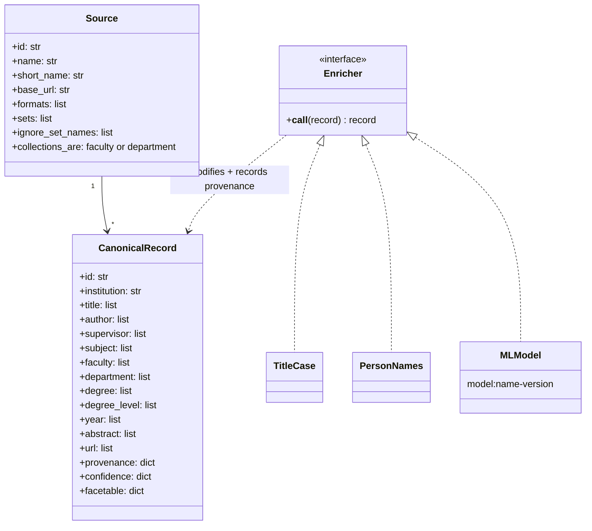

### 4.3 Field mapping (crosswalk)
| Canonical | `dim` source fields (priority order) | Fallbacks |
|---|---|---|
| title | `dc.title` | — |
| author | `dc.contributor.author`, `dc.creator` | — |
| supervisor | `dc.contributor.advisor`, `.supervisor`, `.promoter` | ML/PDF (planned) |
| subject | `dc.subject`, `.other`, `.lcsh`, `.ddc` | — |
| faculty | `thesis.degree.faculty`, local fields | set hierarchy (`collections_are`, "School/Faculty of …") |
| department | `thesis.degree.department`, local fields | set hierarchy; "Department of …" pattern in descriptions |
| degree, discipline | `thesis.degree.name`, `thesis.degree.discipline` | "Master of X in Y" / "PhD Y" patterns in `dc.description` |
| degree_level | `thesis.degree.level` | patterns over degree, type, description and set names |
| year | `dc.date.issued` | first 4-digit year |
| url | `dc.identifier.uri` | — |

### 4.4 Solr document
`id, title_tsim/ssm/ssort, author_tsim/ssim, supervisor_tsim/ssim, subject_tsim/ssim, faculty_tsim/ssim, department_tsim/ssim, faculty_department_ssim ("Faculty|Dept"), discipline_tsim/ssim, degree_ssim, degree_level_ssim, year_isi/ssim, abstract_tesim, url_ssm, pdf_url_ssm, rights_ssm, language_ssim, type_ssim, institution_ssim, institution_short_ssim, source_ssi, oai_id_ssi, datestamp_ssi (source datestamp), updated_dtsi (last content change in the portal; OAI-PMH datestamp), provenance_ssm, derived_ssm (FR-50), completeness_isi`. A facet (`*_ssim`) value is omitted when its field is not `facetable` (FR-17).

---

## 5. Interface viewpoint
| Interface | Description |
|---|---|
| CLI | `python -m netd.cli {harvest|process|index|run|reprocess|report|check|csv-check FILE} [--source ID] [--full] [--limit N] [--db PATH] [--solr URL]`; metadata filling: `extract-text [--limit N] [--retry-failed]`, `ocr-text [--limit N]`, `text-report`, `predict [--model NAME] [--all]`, `load-predictions FILE.jsonl`, `export-predictions FILE.csv`, `correct RECORD FIELD [VALUE ...] --by EMAIL [--note TEXT]`, `uncorrect RECORD FIELD`, `gold-sample FILE.csv [--n N] [--seed S]`, `evaluate GOLD.csv`; env `NETD_DB`, `NETD_SOLR`, `NETD_SOURCES`, `NETD_ENRICHERS` |
| Model contract (§4.1.1) | module with `NAME`, `VERSION`, `FIELDS`, `USES`, `NEEDS_TEXT`, optional `prepare(texts)`, and `predict(meta, text) -> {field: (values, confidence, evidence)}`; registered in `netd/ml/predict.py` `MODELS` |
| Enricher contract | `def enrich(record: dict) -> dict`; set `record["provenance"][field] = "model:<name>-<version>"` and optionally `record["confidence"][field] = float` |
| Solr | JSON `POST /solr/netd/update`; Blacklight queries `/select` (edismax, ETD `qf`) |
| HTTP | `GET /` (search), `/catalog/<id>` (record), `/catalog.json?q=…` (JSON) |
| OAI-PMH | `GET`/`POST /oai` (§5.1) |
| REST API | `GET /api/v1/…` (§5.3), JSON; specification `/api/v1/openapi.yaml` |
| Admin panel | `/admin` (§5.2), signed-in portal team only |
| Accounts | `deploy/ops/netd-user.sh add|reset|disable|enable|list` (root on the server; Rake tasks `netd:user:*`) |

### 5.1 OAI-PMH data provider (EI-4)
`OaiController` (`portal/app/controllers/oai_controller.rb`) answers OAI-PMH 2.0 at https://netd.ac.zm/oai. It reads Solr only, so the harvester's SQLite store is never touched by web requests, and it needs no new service.

| Aspect | Design |
|---|---|
| Verbs | `Identify`, `ListMetadataFormats`, `ListSets`, `ListIdentifiers`, `ListRecords`, `GetRecord`; GET or POST; repeated, missing or illegal arguments give `badArgument`, an unknown verb gives `badVerb` |
| Identifiers | `oai:netd.ac.zm:<Solr id>`, e.g. `oai:netd.ac.zm:unza-123456789-9150` |
| Datestamp | `updated_dtsi`: when the record's canonical content last changed (`records.updated_at`, which `Store.put_record` leaves alone when a reprocessed record is unchanged). Granularity `YYYY-MM-DDThh:mm:ssZ`; `from`/`until` accept days or seconds (same granularity for both) |
| Sets | `inst:<source id>` (from a Solr pivot of `source_ssi` and `institution_ssim`) and `level:masters`, `level:doctoral` (`degree_level_ssim`) |
| Formats | `oai_dc`; `etdms` (ETD-MS v1.1, elements in schema order, supervisors as `contributor role="advisor"`, `degree` with name, level, discipline (or department) and grantor). Identifiers are the portal record page, the source landing page and the full-text link |
| Paging | 100 records per page; Solr `cursorMark` with `sort=id asc`. Resumption tokens are stateless: URL-safe Base64 JSON of prefix, set, date bounds, cursor mark, cursor and a 24-hour expiry; `completeListSize` and `cursor` are given |
| Deletions | `deletedRecord=transient`: records the harvester removes disappear from Solr |
| Errors | `badVerb`, `badArgument`, `cannotDisseminateFormat`, `idDoesNotExist`, `noRecordsMatch` (also for an unknown set), `badResumptionToken`; `noSetHierarchy` does not apply |
| Monitoring | `netd.cli check` fails if `Identify` does not answer (NFR-12) |
| Verification | `tests/oai_conformance.py` (Sickle and lxml): validates responses against the OAI-PMH and `oai_dc` schemas, checks ETD-MS element order, harvests every record in each format through resumption tokens, and exercises sets, dates, `GetRecord` and every error condition |

---

### 5.2 Admin panel (FR-36 to FR-41)
The panel is part of the Rails portal (no new service). Every admin controller inherits from `Admin::BaseController`, which includes `AdminAuthentication`; public controllers never do.

| Page | Route | Controller | Requirement |
|---|---|---|---|
| Sign in / out | `GET`/`POST /admin/sign-in`, `DELETE /admin/sign-out` | `Admin::SessionsController` (rate-limited) | FR-36 |
| Change password | `/admin/password/edit` | `Admin::PasswordsController` (forced while `must_change_password`) | FR-36 |
| Dashboard | `/admin` | `Admin::DashboardController#index` | FR-37 |
| Source page, Run now | `/admin/sources/<id>`, `POST /admin/sources/<id>/run` | `Admin::DashboardController#source`, `#run` | FR-37 |
| Problem reports | `/admin/reports`, `/admin/reports/<id>` | `Admin::ProblemReportsController` | FR-38 |
| Upload CSV (check, then load) | `/admin/csv/new`, `POST /admin/csv`, `POST /admin/csv/load` | `Admin::CsvUploadsController` | FR-39, FR-40 |
| Activity log | `/admin/log` | `Admin::EventsController` | FR-41 |
| Correct a record (lookup box in the admin bar; record page with values, provenance, corrections and predictions; Apply now) | `GET /admin/records?id=`, `/admin/records/<id>`, `POST /admin/records/<id>/corrections`, `DELETE /admin/records/<id>/corrections/<field>`, `POST /admin/records/<id>/apply` | `Admin::RecordsController` | FR-51 |
| Degree-level review (waiting / decided) | `/admin/review`, `POST /admin/review/<id>` (`decision=exclude\|include`) | `Admin::ReviewsController` | FR-52 |

Corrections and review decisions are written by `netd.cli correct` / `uncorrect` (the panel opens the staging store read-only, as for CSV loading) and logged as `record_corrected`, `correction_removed`, `level_review_excluded`, `level_review_kept` and `reprocess_started`. "Apply now" runs `netd.cli reprocess --source <id>` (process and index, no harvest) under the harvest lock; when the lock is held, the change waits for the next run.

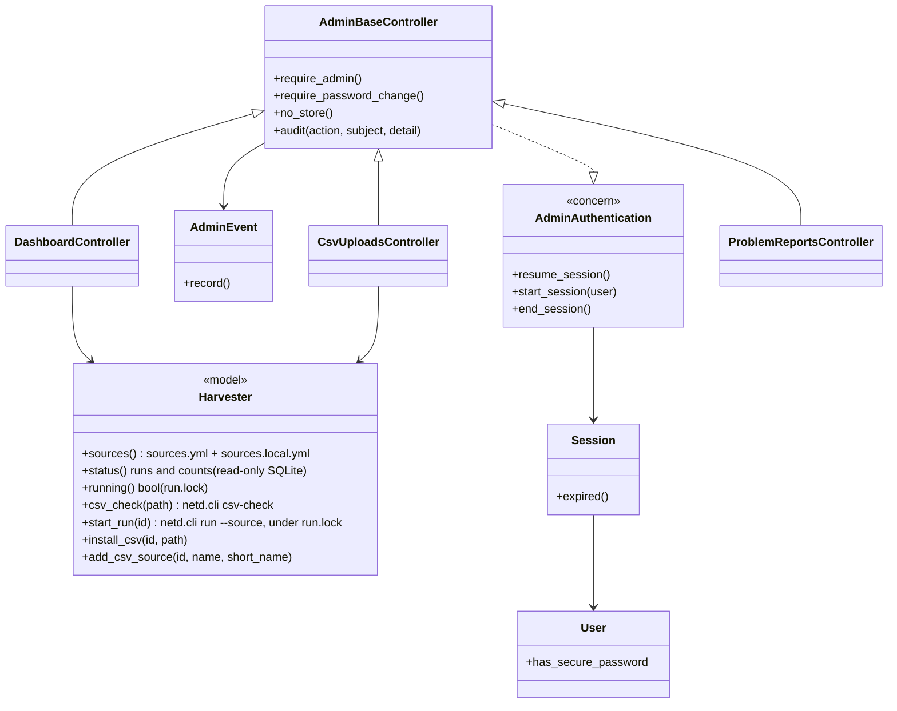

Sign-in and session (FR-36, NFR-13): `SessionsController#create` checks the bcrypt hash, creates a `sessions` row and sets the signed, HTTP-only, `Secure`, `SameSite=Lax` cookie `netd_admin_session` holding its id. Each request looks the session up, rejects it if the account is disabled or the session has been idle for 2 hours or is 12 hours old, and refreshes its `updated_at` at most once a minute. A one-time password (from `netd-user.sh add` or `reset`) sends the user to the password page until it is changed; changing it signs out the account's other sessions. Admin responses carry `Cache-Control: no-store` and `X-Robots-Tag: noindex`, and `robots.txt` disallows `/admin`.

The panel and the harvester (FR-37, FR-39, FR-40): the portal reads the staging store read-only and never writes to it. Anything that changes data runs `netd.cli` as a background process, as the same `netd` user, under `flock` on `harvester/run.lock`; the nightly `netd-harvest.service` takes the same lock (waiting up to 2 hours), so harvests never overlap. CSV upload has two steps:

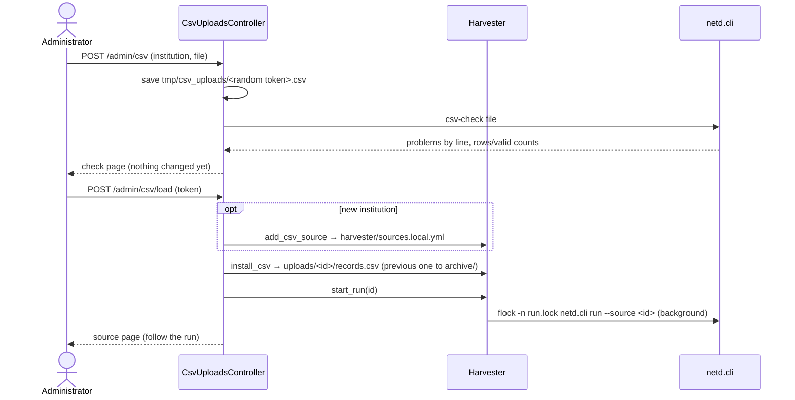

Sources added from the panel are written to `harvester/sources.local.yml` (server only, not in git), which `netd.cli` reads together with `sources.yml`. Moving such a source into `sources.yml` is a normal code change.

### 5.3 REST API v1 (EI-6, FR-42 to FR-46)
Since API 1.1.0 each record carries `derived` (FR-50), built by `ApiRecord.derived` from the Solr field `derived_ssm` (one JSON object per derived field: field, method, confidence); field names follow the API (`supervisors`, `subjects`). The addition changes no existing field (EI-6).

A read-only JSON API inside the Rails portal. Its controllers inherit from `Api::V1::BaseController` (`ActionController::API`: no sessions, cookies or CSRF), which adds CORS headers, the per-address rate limit and JSON error handling. Like the OAI-PMH provider, it reads Solr only. The contract is `portal/public/api/v1/openapi.yaml` (OpenAPI 3.0.3), which Developer Resources renders with Swagger UI at `/developers/api`.

| Endpoint | Controller | Solr use | Requirement |
|---|---|---|---|
| `GET /api/v1/records` | `RecordsController#index` | `/select`: `q` with edismax and the portal's `qf`/`pf` (per field through `${title_qf}` etc.), filters as `fq` (`{!term}`, `{!terms}`, ranges), `start`/`rows` | FR-42 |
| `GET /api/v1/records/{id}` | `RecordsController#show` | `{!term f=id}` | FR-43 |
| `GET /api/v1/institutions` | `InstitutionsController#index` | facet on `institution_ssim`; joined with `InstitutionRegistry` and `Harvester` (source ids, last runs) | FR-44 |
| `GET /api/v1/stats` | `StatsController#index` | facets on `source_ssi`, `degree_level_ssim`, `year_isi`, and `source_ssi` once per completeness field with an `fq` for its presence (9 requests, cached 10 minutes) | FR-45 |
| `GET /api/v1/export.csv`, `.jsonl` | `ExportsController#show` | `cursorMark` over all records, 500 at a time, `sort=id asc` | FR-46 |

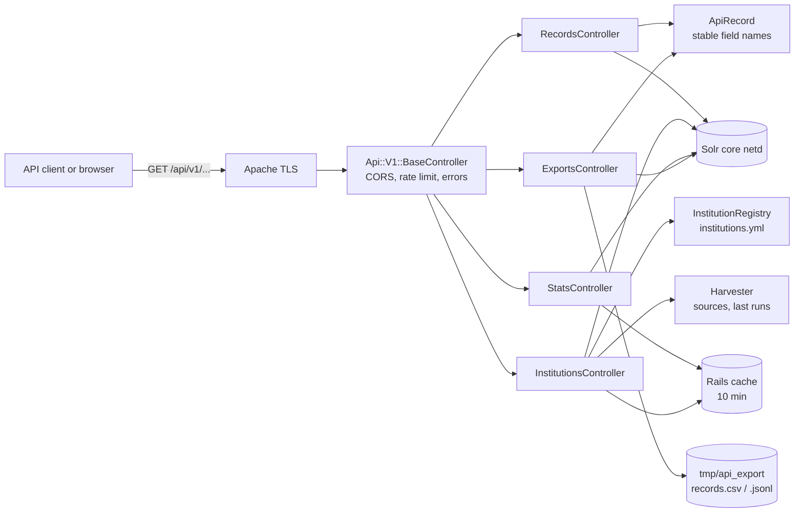

- **Representation.** `ApiRecord` maps Solr documents to the public field names (`title`, `authors`, `supervisors`, `degree_level`, `institution {id, name}`, `links {portal, source, pdf, api}`, `files`, `updated_at`), so index changes do not reach clients. Lists are always arrays and missing single values are `null`.
- **Paging.** `page`/`per_page` up to 10,000 results (Solr `start`/`rows` stay cheap at that depth); the response gives `meta.total`, `meta.pages` and `links.next`/`prev`. Complete copies come from the export or OAI-PMH, which page with `cursorMark`.
- **Export.** Built on demand into `portal/tmp/api_export/` when the file is missing or more than 6 hours old, under an exclusive lock so concurrent requests wait for one build; written to a temporary file and renamed, then sent with `Last-Modified`.
- **Limits and errors.** Rails 8 `rate_limit` (cache-store counters, per address and controller): 120 a minute, and 20 an hour for the export. Unknown parameters, bad values and paging beyond the limit give 400 with a specific message; unknown paths 404; Solr unavailable 503.
- **Versioning.** The version is in the path. Within v1 fields are only added, never renamed or removed; an incompatible change means `/api/v2`, with v1 kept for at least 6 months (EI-6). The older `/catalog.json` view (EI-3) is unchanged and documented as subject to change.

## 6. Interaction viewpoint

### 6.1 Scheduled harvest and indexing
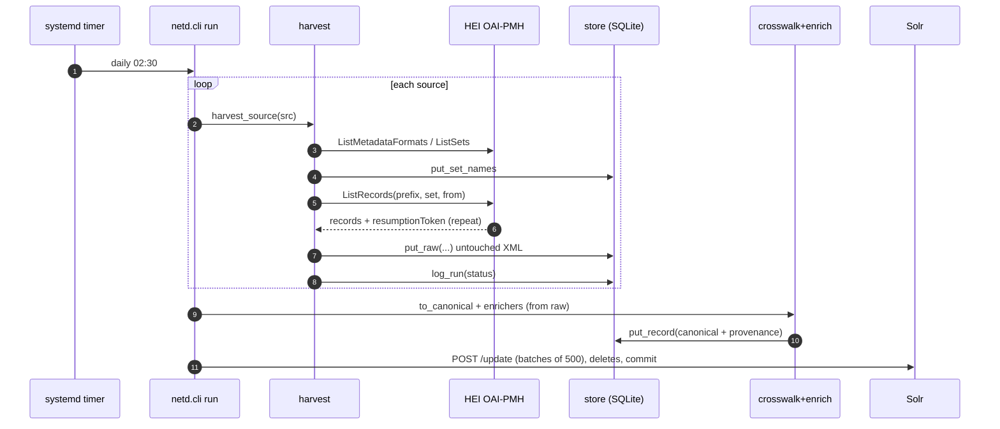

### 6.2 Plugging in an ML model
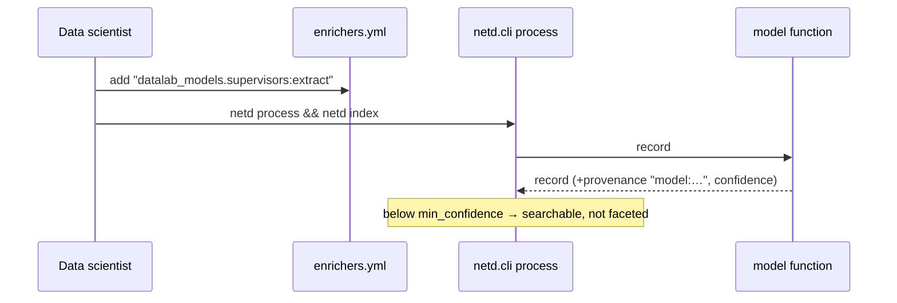

### 6.3 Search
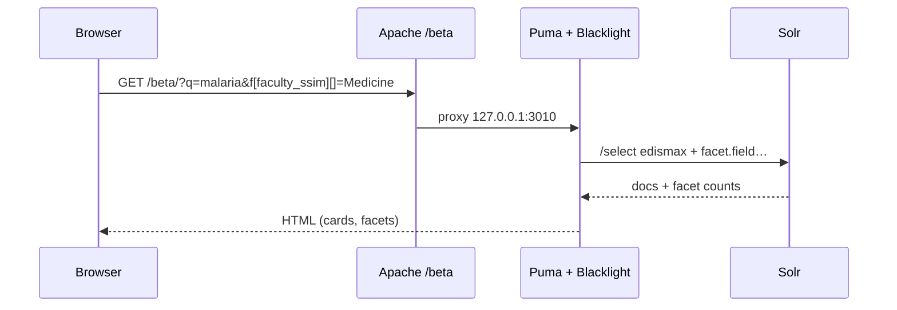

---

## 7. State dynamics viewpoint (harvest run)
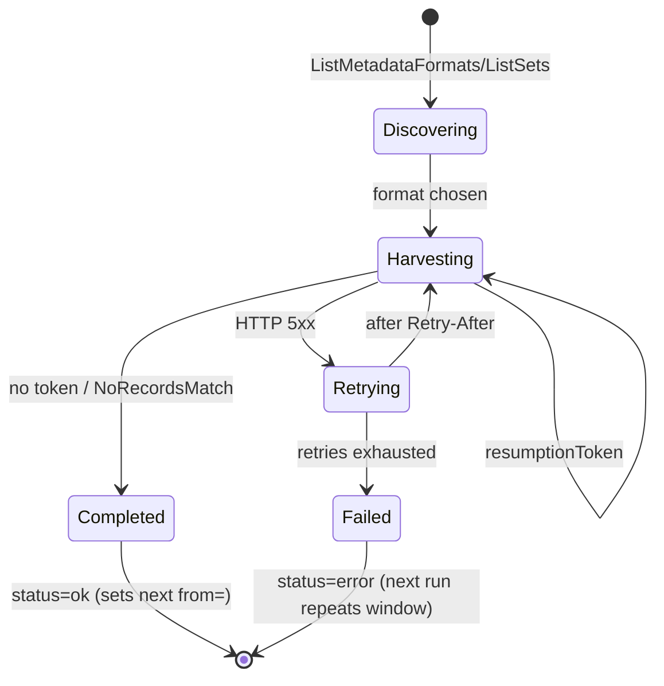

---

## 8. Deployment viewpoint
```mermaid
flowchart TB
  subgraph server ["Server portal — netd.ac.zm — Ubuntu 26.04.1, 2 vCPU, 3.8 GiB + 2 GiB swap"]
    AP[Apache 2.4 :80/:443<br/>netd.ac.zm: / → Puma; HTTP → HTTPS]
    TC["Tomcat :8080<br/>other applications; old portal no longer proxied"]
    PU[netd-portal.service<br/>Puma 127.0.0.1:3010, 1 worker]
    SO[netd-solr.service<br/>Solr 9.11 127.0.0.1:8983, 512 MB heap]
    TI[netd-harvest.timer<br/>daily harvest+process+index, then check]
    BK[netd-backup.timer<br/>nightly backup + Drive copy]
    PR[netd-probe.timer<br/>site check every 15 min]
    AL[netd-alert@ unit<br/>email via SMTP]
    FS["/opt/netd: harvester, portal, solr, ruby, netd.sqlite3"]
  end
  AP --> PU
  PU --> SO
  TI --> SO
  BK --> GD[(Google Drive<br/>NETD portal backups)]
  TI -. OnFailure .-> AL
  BK -. OnFailure .-> AL
  PR -. OnFailure .-> AL
```

- All NETD services run as the unprivileged user `netd` (NFR-5) and are installed under `/opt/netd`.
- Admin panel state on the server: accounts, sessions and the activity log in the portal database; CSV files in `harvester/uploads/<id>/` (current `records.csv`, earlier ones in `archive/`); panel-added sources in `harvester/sources.local.yml`. The nightly backup includes all three (`csv-sources.tgz` holds the files). A harvest started from the panel runs inside the Puma service's process group, so restarting the portal (for example during a deployment) stops it; the next run finishes the job.
- No Docker (C1). Python comes via `uv`; Ruby is compiled with `ruby-build` (rebuilt in place after an OS release upgrade: `deploy/ops/upgrade/rebuild-ruby.sh`). System packages are not upgraded or removed; the only additions are `tesseract-ocr`, `tesseract-ocr-eng` and `poppler-utils` for OCR (FR-48, November 1, 2026).
- The staging store is in WAL mode with a 120 s busy timeout (NFR-14). Only `netd` opens it (the backup runs `sqlite3 .backup` as `netd` through `runuser`), so no root-owned `-wal`/`-shm` files can block the harvester.
- PDF text extraction and OCR run as transient units (`systemd-run --unit=netd-mltext --uid=netd --nice=10`) or by hand, in batches under `run.lock`; see `docs/OPERATIONS.md`.
- Apache sites for netd.ac.zm live in `deploy/apache/` and are installed by `deploy.sh`, which backs up the previous files in `/opt/netd/`. Rollback: restore those backups and restart Apache.
- Operations (NFR-11, NFR-12): every NETD unit has `OnFailure=netd-alert@%n.service`, which emails the unit's status and log. The harvest service ends with `netd.cli check`, which fails if a source's latest run failed or is stale, or if Solr per-source counts fall below 90% of the store. `netd-backup.sh` writes a dated folder only when every step succeeds, and `netd-backup-to-gdrive.sh` copies and verifies it with rclone. The Solr index is not backed up because it is rebuilt from the store. Details and the restore procedure are in `docs/OPERATIONS.md`.
- The earlier ETD Portal (Tomcat :8080) is no longer proxied; Tomcat keeps running because it hosts other applications.

---

## 9. Design rationale
| Decision | Alternatives considered | Reason |
|---|---|---|
| Custom Python pipeline + Blacklight | InvenioRDM; VuFind; DSpace as aggregator | ML models are Python; the raw store makes cleaning re-runnable; InvenioRDM's harvester module is experimental and its "harvest always wins" policy overwrites cleaning; the server's RAM (3.8 GiB, shared) rules out an Invenio stack |
| SQLite (v0.1) | PostgreSQL | Zero extra memory or daemon; adequate for ≤ 100k records; can migrate later |
| `dim` before `etdms`/`oai_dc` | `oai_dc` only | Retains qualified DSpace fields (advisor, local fields) |
| Set hierarchy for Faculty | Manual mapping only | UNZA RIMS ETD collections are Schools; derivable with provenance `set:` |
| Provenance and confidence on every value | Overwrite in place | Lets the team measure each model's contribution; low-confidence values don't pollute facets |
| Sub-path `/beta` | New sub-domain | No DNS change needed (constraint C3) |
| Native systemd services | Docker | Lower memory overhead on a shared 4 GB server |
| REST API v1 in Rails on `ActionController::API`, own representation and OpenAPI file | Blacklight's `.json` views only; GraphQL; a separate API service | `.json` exposes Solr field names and changes with the interface; GraphQL adds a dependency and is harder to cache and rate-limit; no new service or memory; the OpenAPI file gives clients a contract and generated documentation |
| Admin panel inside the Rails portal, Rails 8 built-in authentication | A separate admin application; Devise; HTTP basic authentication in Apache | No new service or memory; one gem (`bcrypt`); sessions can be listed, expired and audited, unlike basic authentication; accounts from the command line keep the attack surface small |
| OAI-PMH provider in Rails, reading Solr | A separate OAI server (e.g. jOAI); serving from the SQLite store | No extra service or memory; Solr already holds every exposed field; stateless tokens survive Puma restarts |

## 10. Known limitations (v0.8)
- Supervisor and Department are empty in every source's harvested metadata; they are now filled from PDF front matter by the baseline model where its confidence reaches 0.8 (FR-14). Older UNZA ETDs are scanned and depend on OCR; about 15% of UNZA PDF links return HTTP 500 from the repository. UNILUS PDF links point to an internal address the portal cannot reach.
- 30 of the 34 HEA-listed institutions show 0 (no reachable ETD repository).
- HTTPS for netd.ac.zm is in place (NFR-9); HTTP redirects to HTTPS since v0.8.
- The old portal's OAI-PMH endpoint (/OAI-PMH) is retired with it; NETD v2's own provider at /oai (EI-4) replaces it from release 0.18.
- No deduplication (FR-19).
