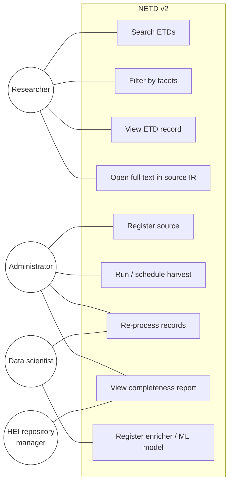
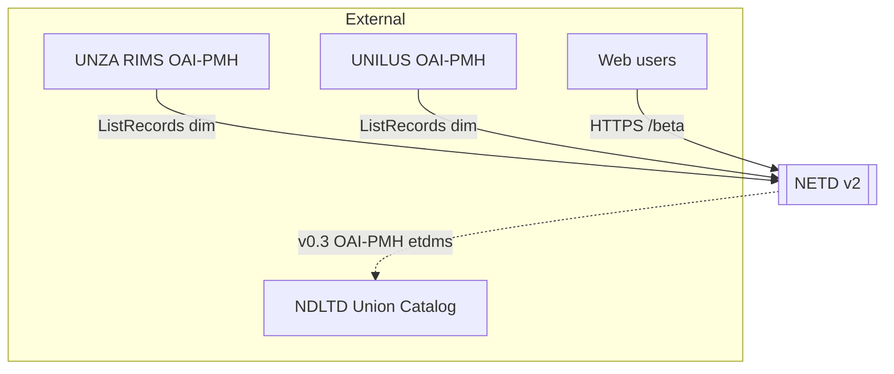
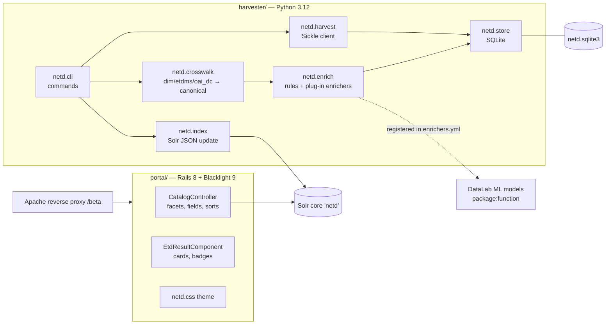
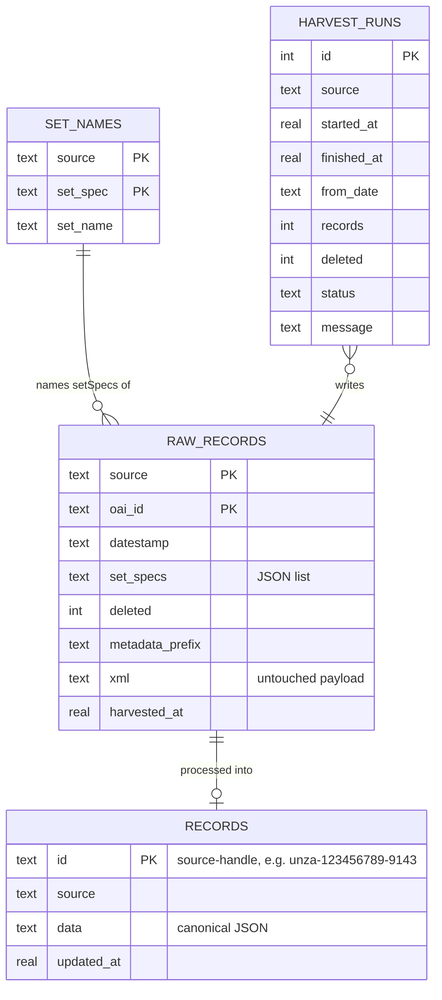
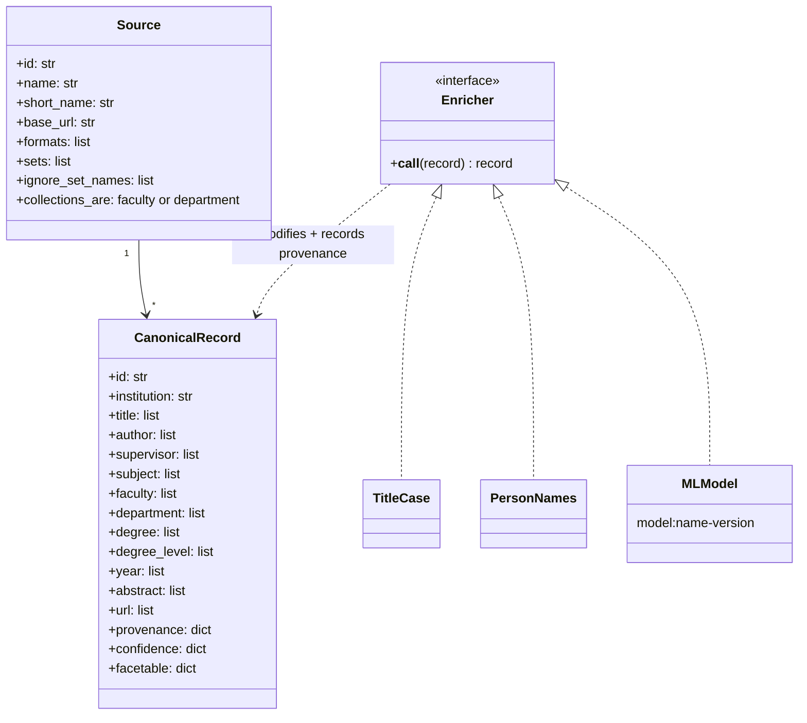
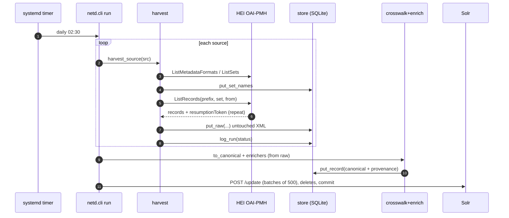
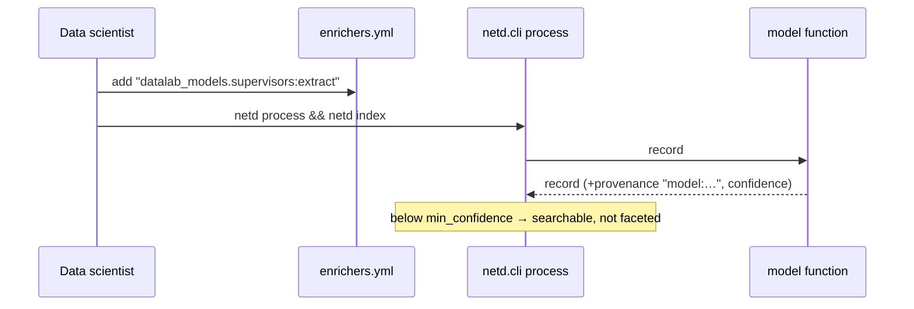
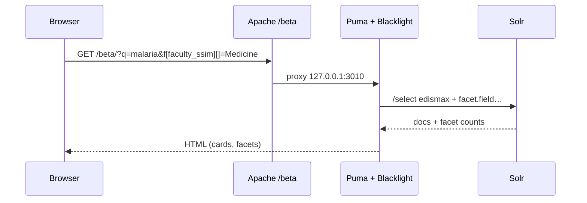
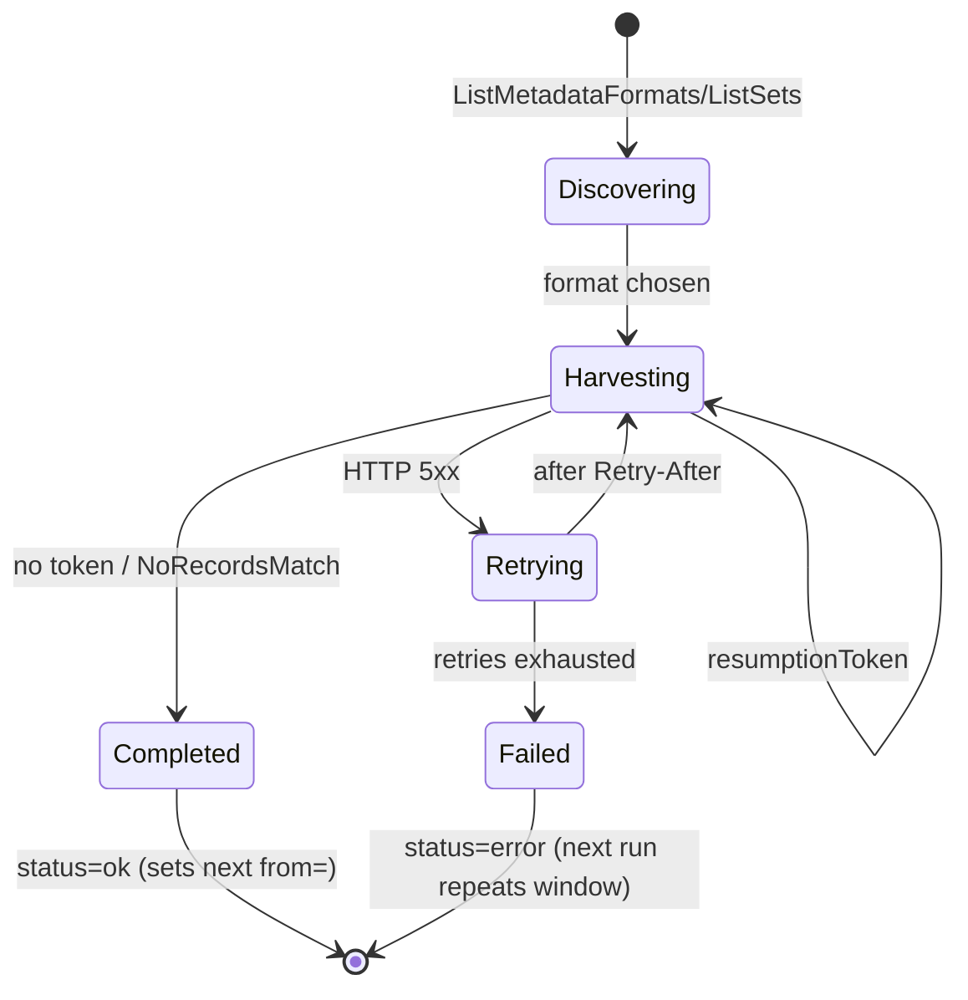
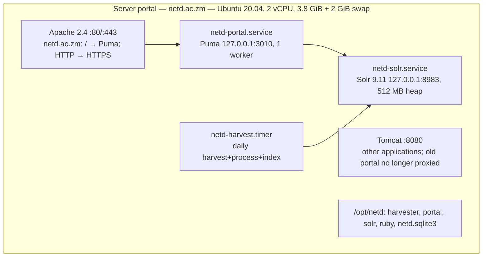

# Software Design Description (SDD)
## Zambia National ETD Aggregator (NETD v2)

| Item | Value |
|---|---|
| Document | SDD, structured per IEEE 1016-2009 (design viewpoints) |
| Version | 0.16 |
| Date | October 31, 2026 |
| Owner | Dr Lighton Phiri, DataLab Research Group, University of Zambia |
| Related | `docs/SRS.md` (requirement IDs referenced below) |

### Revision history
| Version | Date | Changes |
|---|---|---|
| 0.1 | October 30, 2026 | Initial design: harvester, raw/canonical stores, crosswalk, enrichers, Blacklight portal, deployment |
| 0.2 | October 30, 2026 | Discipline/degree derivation; Solr analysers; URL-safe record ids; HTTPS |
| 0.16 | October 31, 2026 | `PagesController#faq/#developers/#credits`; footer partial; `credits` section in `publications.yml`; ZAMREN logo in `public/images/` |
| 0.10 | October 31, 2026 | Record page `catalog/show.html.erb` + `RecordHelper`; index gains `files_ssm` (name, type, size, URL per file) and `rights_ssm` |
| 0.9 | October 31, 2026 | `NetdHeaderComponent` (header), landing page redesign, new theme `netd.css` modelled on Academic Commons |
| 0.8 | October 31, 2026 | Served at the site root; Apache sites managed in `deploy/apache` (HTTP→HTTPS, redirects for `/beta` and old portal paths, `/znrp` and `/ojs` excluded); old Tomcat portal no longer proxied |
| 0.5 | October 31, 2026 | `bitstreams` table; file links from OAI `ore`, DSpace REST bundles and METS; `pdf_url`, `full_text_ssim` |
| 0.4 | October 31, 2026 | DSpace 6 METS loader (`netd.mets`); HTTPS proxy passes X-Forwarded-Proto (fixes record clicks) |
| 0.3 | October 31, 2026 | DSpace REST loader (`netd.rest`); institution registry, zero-count Institution facet and home page; About page from `publications.yml` |

---

## 1. Introduction
### 1.1 Purpose and scope
This SDD describes how NETD v2 meets the SRS: the system's context, components, information model, interfaces, interaction, state, deployment, and the main design decisions. It covers release 0.16.

### 1.2 Stakeholders and concerns
| Stakeholder | Concerns | Viewpoints |
|---|---|---|
| DataLab developers | Structure, extension points, deployment | Composition, Interface, Deployment |
| Data scientists | Where ML models plug in; provenance | Information, Interaction (§6.2) |
| Portal administrator | Operation, resource use, recovery | Deployment, State |
| Project lead / reviewers | Alignment with SA NETD and NDLTD; trade-offs | Context, Rationale |

---

## 2. Context viewpoint

### 2.1 Use cases

### 2.2 System context

---

## 3. Composition viewpoint (components)

| Component | Responsibility | SRS |
|---|---|---|
| `netd.harvest` | OAI-PMH client, format choice, sets, incremental runs, retries, run log | EI-1, FR-2–FR-8 |
| `netd.store` | Raw layer, set names, canonical layer, harvest runs | FR-7, FR-11 |
| `netd.crosswalk` | Flattening of `dim`/`etdms`/`oai_dc`; field mapping; set-based and text-based derivation; provenance | FR-12–FR-15 |
| `netd.enrich` | Built-in rules; loading and running external enrichers; confidence → facetable | FR-16–FR-18 |
| `netd.index` | Canonical → Solr document (Blacklight dynamic-field names) | FR-21 |
| `netd.rest` | Fallback loader: DSpace 7 REST API items → `dim` XML in the raw layer (set specs from collection and parent community) | FR-10 |
| file links (all loaders) | OAI-PMH sources: second `ListRecords` pass in `ore`, taking `ore:aggregates` links (DSpace 7 UI download links normalised to `/server/api/core/bitstreams/<uuid>/content` on the repository host); REST: item ORIGINAL bundle; METS: CONTENT file group. Stored in table `bitstreams`; crosswalk sets `pdf_url` (largest PDF first) or `file_url` | FR-32 |
| `netd.mets` | Fallback loader: DSpace 6 XMLUI collection browse pages → item handles → `/metadata/handle/<h>/mets.xml` → embedded `dim` stored in the raw layer | FR-10 |
| `netd.cli` | `harvest`, `process`, `index`, `run`, `report` | FR-9, FR-27 |
| `institutions.yml` + `InstitutionRegistry` | All HEA-accredited postgraduate HEIs with harvest status | FR-29 |
| `InstitutionFacetComponent` | Institution facet listing registry institutions with no records as 0 (hidden once an institution is selected) | FR-29 |
| `NetdHeaderComponent` | Group bar, wordmark, search box, link row (About, Explore, Master's, PhD) | EI-5 |
| Home page (`catalog/_home_text`) | Intro line; Explore Master's/PhD cards; stats at a glance; contributing institutions with the HEA list behind a toggle | FR-26, FR-30, FR-33 |
| `PagesController#about` + `publications.yml` | Project details and publications; `deploy/gen_publications_md.py` writes `PUBLICATIONS.md` from the same file | FR-31 |
| Blacklight portal | Search UI, facets, sorting, record pages, JSON API | FR-20–FR-24, EI-3, EI-5 |
| Solr core `netd` | Blacklight schema (ICU analysers replaced by built-in ASCII folding, as the slim Solr distribution lacks the ICU module); `qf` tuned to ETD fields | NFR-1 |

---

## 4. Information viewpoint

### 4.1 Persistent data (SQLite)

### 4.2 Canonical record (class view)

### 4.3 Field mapping (crosswalk)
| Canonical | `dim` source fields (priority order) | Fallbacks |
|---|---|---|
| title | `dc.title` | — |
| author | `dc.contributor.author`, `dc.creator` | — |
| supervisor | `dc.contributor.advisor`, `.supervisor`, `.promoter` | ML/PDF (planned) |
| subject | `dc.subject`, `.other`, `.lcsh`, `.ddc` | — |
| faculty | `thesis.degree.faculty`, local fields | set hierarchy (`collections_are`, "School/Faculty of …") |
| department | `thesis.degree.department`, local fields | set hierarchy; "Department of …" pattern in descriptions |
| degree, discipline | `thesis.degree.name`, `thesis.degree.discipline` | "Master of X in Y" / "PhD Y" patterns in `dc.description` |
| degree_level | `thesis.degree.level` | patterns over degree, type, description and set names |
| year | `dc.date.issued` | first 4-digit year |
| url | `dc.identifier.uri` | — |

### 4.4 Solr document
`id, title_tsim/ssm/ssort, author_tsim/ssim, supervisor_tsim/ssim, subject_tsim/ssim, faculty_tsim/ssim, department_tsim/ssim, faculty_department_ssim ("Faculty|Dept"), discipline_tsim/ssim, degree_ssim, degree_level_ssim, year_isi/ssim, abstract_tesim, url_ssm, institution_ssim, institution_short_ssim, provenance_ssm, completeness_isi`. A facet (`*_ssim`) value is omitted when its field is not `facetable` (FR-17).

---

## 5. Interface viewpoint
| Interface | Description |
|---|---|
| CLI | `python -m netd.cli {harvest|process|index|run|report} [--source ID] [--full] [--limit N] [--db PATH] [--solr URL]`; env `NETD_DB`, `NETD_SOLR`, `NETD_SOURCES`, `NETD_ENRICHERS` |
| Enricher contract | `def enrich(record: dict) -> dict`; set `record["provenance"][field] = "model:<name>-<version>"` and optionally `record["confidence"][field] = float` |
| Solr | JSON `POST /solr/netd/update`; Blacklight queries `/select` (edismax, ETD `qf`) |
| HTTP | `GET /beta/` (search), `/beta/catalog/<id>` (record), `/beta/catalog.json?q=…` (JSON) |

---

## 6. Interaction viewpoint

### 6.1 Scheduled harvest and indexing

### 6.2 Plugging in an ML model

### 6.3 Search

---

## 7. State dynamics viewpoint (harvest run)

---

## 8. Deployment viewpoint

- All NETD services run as the unprivileged user `netd` (NFR-5) and are installed under `/opt/netd`.
- No Docker and no apt changes (C1). Python comes via `uv`; Ruby is compiled with `ruby-build`.
- Apache sites for netd.ac.zm live in `deploy/apache/` and are installed by `deploy.sh`, which backs up the previous files in `/opt/netd/`. Rollback: restore those backups and restart Apache.
- The earlier ETD Portal (Tomcat :8080) is no longer proxied; Tomcat keeps running because it hosts other applications.

---

## 9. Design rationale
| Decision | Alternatives considered | Reason |
|---|---|---|
| Custom Python pipeline + Blacklight | InvenioRDM; VuFind; DSpace as aggregator | ML models are Python; the raw store makes cleaning re-runnable; InvenioRDM's harvester module is experimental and its "harvest always wins" policy overwrites cleaning; the server's RAM (3.8 GiB, shared) rules out an Invenio stack |
| SQLite (v0.1) | PostgreSQL | Zero extra memory or daemon; adequate for ≤ 100k records; can migrate later |
| `dim` before `etdms`/`oai_dc` | `oai_dc` only | Retains qualified DSpace fields (advisor, local fields) |
| Set hierarchy for Faculty | Manual mapping only | UNZA RIMS ETD collections are Schools; derivable with provenance `set:` |
| Provenance and confidence on every value | Overwrite in place | Lets the team measure each model's contribution; low-confidence values don't pollute facets |
| Sub-path `/beta` | New sub-domain | No DNS change needed (constraint C3) |
| Native systemd services | Docker | Lower memory overhead on a shared 4 GB server |

## 10. Known limitations (v0.8)
- Supervisor and Department are empty for all harvested sources: the IRs don't expose them. ML/PDF extraction is deferred until the portal is complete.
- 30 of the 34 HEA-listed institutions show 0 (no reachable ETD repository).
- HTTPS for netd.ac.zm is in place (NFR-9); HTTP redirects to HTTPS since v0.8.
- The old portal's OAI-PMH endpoint (/OAI-PMH) is retired with it; NETD v2's own OAI-PMH provider (EI-4) is not built yet.
- No OAI-PMH provider yet (EI-4); no deduplication (FR-19).
