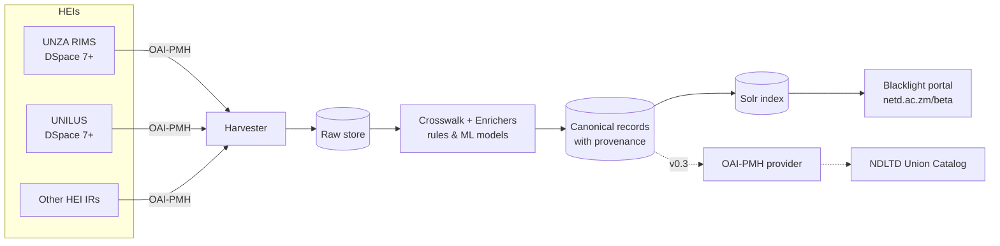

# Software Requirements Specification (SRS)
## Zambia National ETD Aggregator (NETD v2) — Harvesting, Cleaning and Discovery Service

| Item | Value |
|---|---|
| Document | SRS, structured per ISO/IEC/IEEE 29148:2018 (supersedes IEEE 830-1998) |
| Version | 0.1 (bare implementation, "beta") |
| Date | October 30, 2026 |
| Owner | Dr Lighton Phiri, DataLab Research Group, University of Zambia |
| Repository | https://github.com/lightonphiri/code-datalab26-netd_aggregator |
| Status | Draft for review |

---

## 1. Introduction

### 1.1 Purpose
This document specifies the requirements for a national Electronic Theses and Dissertations (ETD) aggregation service for Zambia. The service harvests ETD metadata from Higher Education Institution (HEI) institutional repositories (IRs) using OAI-PMH, cleans and enriches it, and offers faceted discovery by Title, Author, Subject, Supervisor, Faculty and Department. It is intended for the DataLab project team, HEI repository managers, and reviewers such as the Higher Education Authority (HEA).

### 1.2 Scope
The system ("NETD v2") replaces, in stages, the current Zambia National ETD Portal at https://netd.ac.zm, which runs the UCT ETD Portal software [R4] and holds about 5,269 UNZA records [R1]. Version 0.1 runs **alongside** the current portal at `https://netd.ac.zm/beta/` and covers:
- harvesting from two sample HEIs (UNZA RIMS and UNILUS);
- a cleaning pipeline with a plug-in point for DataLab's machine-learning (ML) models;
- a Blacklight 9 discovery interface over Apache Solr.

Out of scope for v0.1: depositing ETDs, user accounts, hosting full texts, and replacing the live portal.

### 1.3 Definitions, acronyms and abbreviations
| Term | Meaning |
|---|---|
| ETD | Electronic Thesis or Dissertation |
| HEI | Higher Education Institution |
| IR | Institutional Repository (e.g. DSpace) |
| OAI-PMH | Open Archives Initiative Protocol for Metadata Harvesting, v2.0 |
| `oai_dc`, `dim`, `etdms` | OAI-PMH metadata formats: unqualified Dublin Core; DSpace Intermediate Metadata; ETD-MS |
| ETD-MS | NDLTD's interoperability metadata standard for ETDs (v1.1) |
| Raw store | Unmodified harvested metadata, kept so cleaning can be re-run |
| Canonical record | Cleaned ETD record with per-field provenance |
| Provenance | The origin of a field value: harvested, derived from sets, extracted from text, or produced by a model |
| Enricher | A cleaning/enrichment function, rule-based or ML, run on canonical records |

### 1.4 References
- [R1] Chileshe, E. & Phiri, L. (2024). *Zambia National ETD Portal: Implementation of an Interoperable National Electronic Thesis and Dissertation Portal.* ETD 2024 poster. https://docs.google.com/presentation/d/18grbYjU2LdcqHDs4V-cququXvMyJCenFykFJUq8xnBc/edit
- [R2] *Quality of Metadata in the Zambia National ETD Portal* (abstract). https://docs.google.com/document/d/1HKeNgRV_AzEjIGdtOKItG0TGanwYF43voNgMNtibj_g/edit
- [R3] *Design and Implementation of an Interoperable Zambia National Electronic Thesis and Dissertation Portal* (ETD 2024 abstract). https://docs.google.com/document/d/1RgbfrHOBhbt5Y1aHFGt0bXS5SZjJ8lUtLVD-mU3t-vM/edit
- [R4] Webley, L., Chipeperekwa, T. & Suleman, H. (2011). *Creating a National Electronic Thesis and Dissertation Portal in South Africa.* ETD 2011. Project page: https://dl.cs.uct.ac.za/projects/etd_portal.html
- [R5] Chanda, Kanfwa & Mainda (2023). *Zambia National ETD Pre-Processing Pipeline.* https://datalab.unza.zm/sites/default/files/2023-12/reports-unza23-ict4014-chanda_kanfwa_mainda.pdf
- [R6] Chisale, A. (2024). MLIS dissertation on ETD-MS compliance in Zambian IRs. https://datalab.unza.zm/sites/default/files/2024-06/etds-datalab24-mlis-dissertation-adrian_chisale.pdf
- [R7] NDLTD (2021). *ETD-MS v1.1.* https://ndltd.org/wp-content/uploads/2021/04/etd-ms-v1.1.html
- [R8] Open Archives Initiative. *OAI-PMH v2.0.* https://www.openarchives.org/OAI/openarchivesprotocol.html
- [R9] NDLTD Union Catalog. https://ndltdunion.cs.uct.ac.za/portal/
- [R10] Project Blacklight. https://projectblacklight.org/
- [R11] ISO/IEC/IEEE 29148:2018 *Systems and software engineering — Life cycle processes — Requirements engineering.*

### 1.5 Overview
Section 2 describes the product context and constraints. Section 3 lists verifiable requirements. Section 4 gives verification methods and traceability.

---

## 2. Overall description

### 2.1 Product perspective
NETD v2 follows the SA NETD multi-tier model [R4]: *Harvester → Repository (store) → Portal*. It adds a **cleaning tier** with provenance between harvesting and indexing, motivated by the metadata-quality findings in [R2], [R5] and [R6]. Downstream, it will in turn expose an OAI-PMH provider so that NDLTD [R9] can harvest Zambia as a single source (planned for v0.3).

### 2.2 Product functions (summary)
1. Register and onboard HEI repositories (source registry).
2. Harvest ETD metadata selectively (by set) and incrementally.
3. Keep raw metadata unchanged, and process it into canonical records.
4. Clean and enrich fields with rules and pluggable ML models, recording provenance.
5. Index records and offer search, faceting, sorting and record pages.
6. Report field completeness per institution.

### 2.3 User classes and characteristics
| User class | Description | Main needs |
|---|---|---|
| Researcher / student (public) | Searches for ETDs nationally | Fast search; facets by institution, faculty, department, supervisor, subject, year; link to full text |
| HEI repository manager | Librarian responsible for an IR | Confirm their ETDs are harvested; see completeness gaps |
| Portal administrator (DataLab) | Runs the service | Add sources, schedule harvests, re-run cleaning, monitor |
| Data scientist (DataLab) | Builds cleaning/ML models | Plug models in without changing platform code; compare model versions |
| Oversight body (HEA) | Reviews national ETD output | Aggregate counts and quality indicators |

### 2.4 Operating environment
- Server `portal` (netd.ac.zm): Ubuntu 20.04.6 LTS, 2 vCPU, 3.8 GiB RAM, 2 GiB swap file, 162 GB free disk. It is shared with other live services: Apache (80/443), Tomcat (current portal, :8080), Orthanc, MySQL and nginx.
- No Docker. Python 3.12 (standalone, via `uv`), Ruby 3.3 (`ruby-build`), OpenJDK 11, Solr 9.11 (slim), SQLite.
- Browsers: current Chrome, Firefox, Edge and Safari, including mobile.

### 2.5 Design and implementation constraints
- C1 Must not disturb the live portal or other services on the server, and must not change system packages (apt is currently in a broken state).
- C2 Memory budget: Solr heap ≤ 512 MB; web app ≤ 300 MB resident.
- C3 Must not depend on actions by third parties (e.g. DNS changes); hence sub-path `/beta`.
- C4 Open-source components only; source code versioned on GitHub.
- C5 ML models are Python; the cleaning tier must be Python.
- C6 British English in the interface and documentation.

### 2.6 Assumptions and dependencies
- A1 HEI repositories expose OAI-PMH. Verified on October 30, 2026 for UNZA RIMS (`https://rims.unza.ac.zm/server/oai/request`) and UNILUS (`https://research.unilus.ac.zm/server/oai/request`). Both offer `dim`, `etdms`, `oai_dc` and others.
- A2 Supervisor and department are **not** present in the harvested metadata of either sample source (0% completeness, measured on October 30, 2026). They will require text/PDF extraction or ML (FR-14).
- A3 Full texts remain in the source IRs; NETD stores links only.

---

## 3. Specific requirements

Priority: **M** = must (v0.1), **S** = should (v0.2), **C** = could (later).

### 3.1 External interface requirements
| ID | Requirement | Pri |
|---|---|---|
| EI-1 | The harvester shall act as an OAI-PMH 2.0 client supporting `Identify`, `ListMetadataFormats`, `ListSets` and `ListRecords`, with resumption tokens. | M |
| EI-2 | The portal shall be served over HTTP(S) at `/beta/` on netd.ac.zm through the existing Apache server (reverse proxy). | M |
| EI-3 | The portal shall offer a JSON view of search results and records (Blacklight `.json`). | S |
| EI-4 | The system shall expose an OAI-PMH data provider (`oai_dc`, `etdms`) of canonical records. | C |
| EI-5 | The UI shall follow a repository-style layout (facet sidebar, result cards with badges, record page with metadata panel) comparable to InvenioRDM. | M |

### 3.2 Functional requirements

**Source management and harvesting**
| ID | Requirement | Pri |
|---|---|---|
| FR-1 | Sources shall be configured in a registry file (`harvester/sources.yml`) giving id, name, short name, base URL, preferred metadata formats, ETD sets, and set-name rules. | M |
| FR-2 | For each source, the harvester shall choose the first preferred format the source offers (default order `dim`, `etdms`, `oai_dc`). | M |
| FR-3 | The harvester shall restrict harvesting to the configured ETD sets. | M |
| FR-4 | The harvester shall support full and incremental (`from=` last successful run minus one day) harvests. | M |
| FR-5 | The harvester shall record OAI deletions and remove deleted records from the index. | M |
| FR-6 | The harvester shall retry on HTTP 500/502/503/504 and honour `Retry-After`. | M |
| FR-7 | Each harvest run shall be logged (source, start/end, from-date, counts, status, message). | M |
| FR-8 | The harvester shall store the set hierarchy (`ListSets`) for each source. | M |
| FR-9 | Harvests shall run on a schedule (daily) without manual action. | S |
| FR-10 | Fallback adapters (DSpace REST API, CSV upload) shall be available for HEIs without working OAI-PMH. | C |

**Processing, cleaning and enrichment**
| ID | Requirement | Pri |
|---|---|---|
| FR-11 | Raw metadata shall be stored unmodified; processing shall be re-runnable from the raw store without re-harvesting. | M |
| FR-12 | A crosswalk shall map `dim`, `etdms` and `oai_dc` to canonical fields: title, author, supervisor, subject, faculty, department, degree, degree level, year, abstract, URL, language, type, institution. | M |
| FR-13 | Faculty/Department shall be derived from the set hierarchy where a source's collections represent units (per-source rule `collections_are`). | M |
| FR-14 | Supervisor, Department and Degree shall be extracted from free-text fields and, later, from PDF front matter. | S (text) / C (PDF) |
| FR-15 | Every canonical field value shall carry provenance (`harvested:`, `set:`, `text:`, `rule:`, `model:`). | M |
| FR-16 | Enrichers shall be pluggable as Python callables `f(record) -> record`, registered in `enrichers.yml` without code changes to the platform. | M |
| FR-17 | Enrichers may set a confidence per field. Values below `min_confidence` shall stay searchable but shall not be used as facet values. | M |
| FR-18 | Built-in rules shall normalise whitespace, ALL-CAPS titles (keeping the original), personal names, and ALL-CAPS unit names. | M |
| FR-19 | Duplicate ETDs across sources shall be detected (identifier, then title+author+year). | C |

**Discovery**
| ID | Requirement | Pri |
|---|---|---|
| FR-20 | Users shall search by keyword across all fields, or within Title, Author, Supervisor or Subject. | M |
| FR-21 | Users shall filter by facets: Institution, Degree level, Faculty/School, Department, Supervisor, Subject, Year. | M |
| FR-22 | Users shall sort by relevance, newest, oldest and title. | M |
| FR-23 | Result cards shall show degree-level, year and institution badges, title, author, supervisor (when present), and an abstract snippet. | M |
| FR-24 | Record pages shall show all canonical fields, link facet values, and link to the record in the source IR. | M |
| FR-25 | Hierarchical Faculty → Department browsing. | S |
| FR-26 | Institution landing pages (InvenioRDM "communities" equivalent). | S |

**Reporting**
| ID | Requirement | Pri |
|---|---|---|
| FR-27 | The administrator shall obtain a per-institution field-completeness report from the command line. | M |
| FR-28 | A public quality dashboard (completeness and ETD-MS compliance per HEI). | C |

### 3.3 Non-functional requirements
| ID | Category | Requirement | Pri |
|---|---|---|---|
| NFR-1 | Performance | Search result pages shall render in ≤ 1.5 s (server time, p95) for 10,000 records. | M |
| NFR-2 | Capacity | v0.1 shall handle ≥ 50,000 records within constraint C2. | M |
| NFR-3 | Resource | Total added resident memory ≤ 1 GB under normal load. | M |
| NFR-4 | Availability | Services shall restart automatically (systemd) after failure or reboot. | M |
| NFR-5 | Isolation | Services run as unprivileged user `netd`; Solr binds to 127.0.0.1 only. | M |
| NFR-6 | Maintainability | Adding a new DSpace source shall need only a registry entry. | M |
| NFR-7 | Portability | Installation scripted (`deploy/install-server.sh`, `deploy/deploy.sh`). | M |
| NFR-8 | Usability | Responsive layout; WCAG 2.1 AA colour contrast for badges and links. | S |
| NFR-9 | Security | HTTPS for netd.ac.zm with a valid certificate (in place since October 30, 2026; Let's Encrypt, auto-renewing). | S |
| NFR-10 | Politeness | At most one concurrent request per source. | M |

### 3.4 Data requirements
The canonical record is a JSON object stored in SQLite (`records.data`):
`id, source, institution, institution_short, oai_id, datestamp, title[], author[], supervisor[], subject[], faculty[], department[], degree[], degree_level[], year[], abstract[], url[], language[], type[], provenance{field: origin}, confidence{field: 0..1}, facetable{field: bool}, raw_fields[]`.

---

## 4. Verification

| Requirement(s) | Method | v0.1 evidence |
|---|---|---|
| EI-1, FR-2–FR-8 | Test: full harvest of both sources | October 30, 2026: UNZA 6,287 headers (37 deleted) and UNILUS 77 (15 deleted), both via `dim`, status ok |
| FR-11–FR-13, FR-15, FR-18 | Test: `netd process`; inspect provenance | 5,798 canonical records; UNZA Faculty 100% from sets |
| FR-27 | Demonstration: `netd report` | Completeness table (below) |
| FR-20–FR-24, EI-2, EI-5 | Demonstration in browser at `/beta/` | Screenshots in release notes |
| NFR-1, NFR-3 | Measurement (`curl -w`, `ps`) | Recorded at deployment |
| NFR-4, NFR-5 | Inspection of systemd units | `deploy/systemd/*.service` |

Baseline completeness (October 30, 2026, after v0.1 rules):

| Institution | Records | Title | Author | Supervisor | Subject | Faculty | Department | Degree level | Year |
|---|---|---|---|---|---|---|---|---|---|
| UNILUS | 62 | 100% | 100% | 0% | 85% | 0% | 0% | 100% | 100% |
| UNZA | 5,736 | 100% | 100% | 0% | 84% | 100% | 0% | 40% | 100% |

These gaps (Supervisor, Department, UNZA degree level) are the targets for the DataLab ML enrichers (FR-14, FR-16).

### 4.1 Traceability to sources
| Need (source) | Requirements |
|---|---|
| Central national access to ETDs [R3] | FR-1–FR-9, FR-20–FR-24 |
| Metadata quality and standardisation [R2], [R5] | FR-11–FR-18 |
| ETD-MS compliance gaps; elements in different places per HEI [R6] | FR-12–FR-14, FR-28 |
| SA NETD tiered architecture [R4] | §2.1 |
| Feed NDLTD [R9] | EI-4 |
| Faceting by Supervisor/Faculty/Department (project brief) | FR-21, FR-25 |
