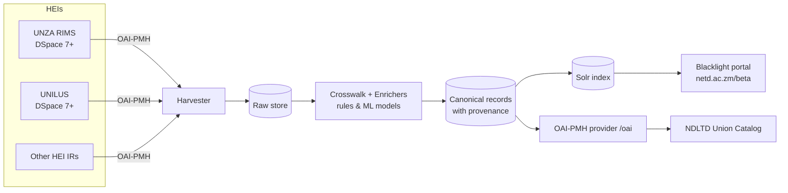

# Software Requirements Specification (SRS)
## Zambia National ETD Aggregator (NETD v2) — Harvesting, Cleaning and Discovery Service

| Item | Value |
|---|---|
| Document | SRS, structured per ISO/IEC/IEEE 29148:2018 (supersedes IEEE 830-1998) |
| Version | 0.28 |
| Date | November 1, 2026 |
| Owner | Dr Lighton Phiri, DataLab Research Group, University of Zambia |
| Repository | https://github.com/lightonphiri/code-datalab26-netd_aggregator |
| Status | Draft for review |

### Revision history
| Version | Date | Changes |
|---|---|---|
| 0.1 | October 30, 2026 | Initial SRS: harvesting (UNZA, UNILUS), cleaning pipeline, Blacklight discovery |
| 0.2 | October 30, 2026 | Discipline and Degree fields (FR-12, FR-21); institution entry points (FR-26); HTTPS (NFR-9); PDF pilot and onboarding findings (§4) |
| 0.26 | November 1, 2026 | Standard fields of study: FR-54 scheme (OpenAlex Topics), FR-55 assignment to every record with back-off, FR-56 exposure (portal facets, record page, REST API `fields_of_study` (API 1.2.0), OAI-PMH `etdms` subject scheme and `oai_dc` URIs, FAQ and Developer Resources), FR-57 model, training data and evaluation; repository subjects shown as "Keywords (from the repository)" |
| 0.28 | November 2, 2026 | Platform: server upgraded Ubuntu 20.04 → 22.04 → 24.04 → 26.04.1 LTS (§ constraints); Ruby 3.3.6 rebuilt against OpenSSL 3.5, harvester venv recreated (uv Python 3.12); no functional requirement changed |
| 0.27 | November 1, 2026 | Institution onboarding: FR-58 weekly check of the repositories of institutions not yet harvested (admin panel, weekly email); FR-59 public guide for institutions ("For Institutions" page); FR-29 status `no-etds-yet` (API 1.3.0); registry survey of November 1, 2026 recorded in §4; FR-28 met: metadata quality by origin of each value against ETD-MS 1.1, overall on the public page `/quality`, per institution in the admin panel `/admin/quality` (CSV and JSON for both); footer Administration sign-in link; FR-60 following new additions (date added, Newest Additions sort, Follow this search with Atom/RSS feeds, API 1.4.0) |
| 0.25 | November 1, 2026 | Metadata filling: FR-14 refined (models over PDF text, prediction cache, precedence, threshold); new FR-48 PDF text cache with OCR, FR-49 prediction cache and models, FR-50 derived values marked on the portal and in the API, FR-51 manual corrections, FR-52 degree-level review and exclusion, FR-53 gold-standard evaluation; FR-43 API record gains `derived` (API 1.1.0); staging store in WAL mode (NFR-14) |
| 0.24 | November 1, 2026 | FR-47 postgraduate scope: records identified as below postgraduate level, or listed per source, are excluded when processing (one UNZA record, a Bachelor of Laws dissertation, excluded); Postgraduate Diploma recognised as a degree level in the cleaning, CSV upload (FR-10), REST API (FR-42, FR-45) and OAI-PMH sets (EI-4) |
| 0.23 | November 1, 2026 | REST API v1 at https://netd.ac.zm/api/v1: EI-6 (interface, OpenAPI 3 specification, versioning, rate limits, CORS), FR-42 to FR-46 (search, record, institutions, statistics, bulk export); EI-3 now describes the search-page JSON as following the website and subject to change; Developer Resources documents the API with an interactive reference |
| 0.22 | November 1, 2026 | Admin panel at https://netd.ac.zm/admin: FR-36 sign-in, FR-37 dashboard and harvest on demand, FR-38 problem-report handling, FR-39 CSV upload with checking, FR-40 adding a CSV institution, FR-41 activity log; NFR-13 admin security; portal administrator user class updated |
| 0.21 | November 1, 2026 | FR-10: CSV loader met, for HEIs without a working repository (file on the server, or a URL the HEI keeps current, read nightly); public template and column guide on Developer Resources; `netd.cli csv-check` |
| 0.20 | October 31, 2026 | EI-4 raised from C to M and met: OAI-PMH 2.0 data provider at https://netd.ac.zm/oai (all six verbs; `oai_dc` and `etdms` (ETD-MS v1.1); sets `inst:<institution>` and `level:masters`/`level:doctoral`; datestamps are the last change of a record in the portal, at seconds granularity); Developer Resources no longer marks it as in development (FR-35) |
| 0.19 | October 31, 2026 | FR-23: abstract snippet (up to three lines) restored under the YEAR · DEGREE · INSTITUTION line; FR-22: 10 results per page by default (as on Google Scholar), with a "Show" menu for 20, 50 or 100 |
| 0.18 | October 31, 2026 | NFR-11 recoverability (nightly backups on the server and Google Drive, restore procedure) and NFR-12 monitoring (failure alerts, site probe, weekly status, post-harvest health check); see `docs/OPERATIONS.md` |
| 0.17 | October 31, 2026 | FR-23: result items as on Academic Commons — authors; YEAR · DEGREE · INSTITUTION; subject links |
| 0.16 | October 31, 2026 | FR-35: footer with About, FAQ, Developer Resources and Credits; FAQ, Developer Resources (REST API; OAI-PMH in development) and Credits pages; ZAMREN hosting credit with logo |
| 0.15 | October 31, 2026 | FR-34: Report a problem popup form (stored and emailed) replaces the email link |
| 0.14 | October 31, 2026 | FR-24: Report a problem email link and Analysis panel (Google Scholar link) on record pages |
| 0.13 | October 31, 2026 | EI-5: header link row limited to About and Explore |
| 0.12 | October 31, 2026 | FR-22: "Sort by" menu as on Academic Commons — Best Match, Published Latest, Published Earliest, Title A-Z, Title Z-A |
| 0.11 | October 31, 2026 | FR-31: About page lists project members with their DataLab roles and only publications based on the Zambia National ETD Portal project, with an explanatory paragraph |
| 0.10 | October 31, 2026 | FR-24: record page modelled on Academic Commons — subject tags, Files panel, More About This Work panel, download/persistent-link panel |
| 0.9 | October 31, 2026 | Interface modelled on Columbia's Academic Commons [R15]: new header and theme (EI-5); landing page with stats at a glance and Master's/PhD explore cards (FR-33) |
| 0.8 | October 31, 2026 | Portal moved to the site root, https://netd.ac.zm/, replacing the earlier ETD Portal; HTTP redirects to HTTPS; /beta and old portal addresses redirect (EI-2, C3, §1.2) |
| 0.7 | October 31, 2026 | FR-21: Year facet lists newest years first, 5 visible with a "more »" toggle |
| 0.6 | October 31, 2026 | FR-29: Institution facet shows the top 10 rows with a "more »" toggle for the rest |
| 0.5 | October 31, 2026 | Direct links to full-text files (FR-32): PDF link on result cards and record pages, Full text facet |
| 0.4 | October 31, 2026 | Mulungushi University harvested via DSpace 6 METS exports (FR-10); EI-2 clarified for HTTPS form posts |
| 0.3 | October 31, 2026 | HEA institution registry with zero counts (FR-29, FR-30); About page with publications (FR-31); ZCAS via DSpace REST fallback (FR-10); ML/PDF extraction deferred until the portal is complete (FR-14); new sources [R12]–[R14] |

---

## 1. Introduction

### 1.1 Purpose
This document specifies the requirements for a national Electronic Theses and Dissertations (ETD) aggregation service for Zambia. The service harvests ETD metadata from Higher Education Institution (HEI) institutional repositories (IRs) using OAI-PMH, cleans and enriches it, and offers faceted discovery by Title, Author, Subject, Supervisor, Faculty and Department. It is intended for the DataLab project team, HEI repository managers, and reviewers such as the Higher Education Authority (HEA).

### 1.2 Scope
The system ("NETD v2") replaces, in stages, the current Zambia National ETD Portal at https://netd.ac.zm, which runs the UCT ETD Portal software [R4] and holds about 5,269 UNZA records [R1]. Since October 31, 2026 (v0.8) it is served at `https://netd.ac.zm/`, replacing the earlier portal, and covers:

- harvesting from four HEIs (UNZA RIMS and UNILUS over OAI-PMH; ZCAS University over the DSpace REST API; Mulungushi University from DSpace 6 METS exports), and listing all HEA-accredited postgraduate institutions [R12], [R13];
- a cleaning pipeline with a plug-in point for DataLab's machine-learning (ML) models;
- a Blacklight 9 discovery interface over Apache Solr.

Out of scope: depositing ETDs, user accounts and hosting full texts. (Replacing the earlier portal was completed in v0.8.)

### 1.3 Definitions, acronyms and abbreviations
| Term | Meaning |
|---|---|
| ETD | Electronic Thesis or Dissertation |
| HEI | Higher Education Institution |
| IR | Institutional Repository (e.g. DSpace) |
| OAI-PMH | Open Archives Initiative Protocol for Metadata Harvesting, v2.0 |
| `oai_dc`, `dim`, `etdms` | OAI-PMH metadata formats: unqualified Dublin Core; DSpace Intermediate Metadata; ETD-MS |
| ETD-MS | NDLTD's interoperability metadata standard for ETDs (v1.1) |
| Raw store | Unmodified harvested metadata, kept so cleaning can be re-run |
| Canonical record | Cleaned ETD record with per-field provenance |
| Provenance | The origin of a field value: harvested, derived from sets, extracted from text, or produced by a model |
| Enricher | A cleaning/enrichment function, rule-based or ML, run on canonical records |

### 1.4 References
- [R1] Chileshe, E. & Phiri, L. (2024). *Zambia National ETD Portal: Implementation of an Interoperable National Electronic Thesis and Dissertation Portal.* ETD 2024 poster. https://docs.google.com/presentation/d/18grbYjU2LdcqHDs4V-cququXvMyJCenFykFJUq8xnBc/edit
- [R2] *Quality of Metadata in the Zambia National ETD Portal* (abstract). https://docs.google.com/document/d/1HKeNgRV_AzEjIGdtOKItG0TGanwYF43voNgMNtibj_g/edit
- [R3] *Design and Implementation of an Interoperable Zambia National Electronic Thesis and Dissertation Portal* (ETD 2024 abstract). https://docs.google.com/document/d/1RgbfrHOBhbt5Y1aHFGt0bXS5SZjJ8lUtLVD-mU3t-vM/edit
- [R4] Webley, L., Chipeperekwa, T. & Suleman, H. (2011). *Creating a National Electronic Thesis and Dissertation Portal in South Africa.* ETD 2011. Project page: https://dl.cs.uct.ac.za/projects/etd_portal.html
- [R5] Chanda, Kanfwa & Mainda (2023). *Zambia National ETD Pre-Processing Pipeline.* https://datalab.unza.zm/sites/default/files/2023-12/reports-unza23-ict4014-chanda_kanfwa_mainda.pdf
- [R6] Chisale, A. (2024). *Identification of Sources for Missing Electronic Theses and Dissertations Metadata in Higher Education in Zambia.* MLIS dissertation, University of Zambia. https://datalab.unza.zm/sites/default/files/2024-06/etds-datalab24-mlis-dissertation-adrian_chisale.pdf
- [R7] NDLTD (2021). *ETD-MS v1.1.* https://ndltd.org/wp-content/uploads/2021/04/etd-ms-v1.1.html
- [R8] Open Archives Initiative. *OAI-PMH v2.0.* https://www.openarchives.org/OAI/openarchivesprotocol.html
- [R9] NDLTD Union Catalog. https://ndltdunion.cs.uct.ac.za/portal/
- [R10] Project Blacklight. https://projectblacklight.org/
- [R11] ISO/IEC/IEEE 29148:2018 *Systems and software engineering — Life cycle processes — Requirements engineering.*

### 1.5 Overview
Section 2 describes the product context and constraints. Section 3 lists verifiable requirements. Section 4 gives verification methods and traceability.

---

## 2. Overall description

### 2.1 Product perspective
NETD v2 follows the SA NETD multi-tier model [R4]: *Harvester → Repository (store) → Portal*. It adds a **cleaning tier** with provenance between harvesting and indexing, motivated by the metadata-quality findings in [R2], [R5] and [R6]. Downstream, it exposes its own OAI-PMH data provider (https://netd.ac.zm/oai, EI-4) so that NDLTD [R9] and other aggregators can harvest Zambia as a single source.

### 2.2 Product functions (summary)
1. Register and onboard HEI repositories (source registry).
2. Harvest ETD metadata selectively (by set) and incrementally.
3. Keep raw metadata unchanged, and process it into canonical records.
4. Clean and enrich fields with rules and pluggable ML models, recording provenance.
5. Index records and offer search, faceting, sorting and record pages.
6. Report field completeness per institution.

### 2.3 User classes and characteristics
| User class | Description | Main needs |
|---|---|---|
| Researcher / student (public) | Searches for ETDs nationally | Fast search; facets by institution, faculty, department, supervisor, subject, year; link to full text |
| HEI repository manager | Librarian responsible for an IR | Confirm their ETDs are harvested; see completeness gaps |
| Portal administrator (DataLab) | Runs the service; signs in to the admin panel (FR-36 to FR-41) | Add sources, run harvests, load CSV files, handle problem reports, monitor |
| Data scientist (DataLab) | Builds cleaning/ML models | Plug models in without changing platform code; compare model versions |
| Oversight body (HEA) | Reviews national ETD output | Aggregate counts and quality indicators |

### 2.4 Operating environment
- Server `portal` (netd.ac.zm): Ubuntu 26.04.1 LTS since November 2, 2026 (was 20.04.6; upgraded one LTS at a time, see `docs/OPERATIONS.md`), 2 vCPU, 3.8 GiB RAM, 2 GiB swap file, 162 GB free disk. It is shared with other live services: Apache (80/443), Tomcat (current portal, :8080), Orthanc, MySQL (8.4) and nginx, and the EMI Drupal site (Drupal 11 on PHP 8.5).
- No Docker. Python 3.12 (standalone, via `uv`), Ruby 3.3 (`ruby-build`), OpenJDK 11, Solr 9.11 (slim), SQLite.
- Browsers: current Chrome, Firefox, Edge and Safari, including mobile.

### 2.5 Design and implementation constraints
- C1 Must not disturb the live portal or other services on the server, and must not upgrade or remove system packages (apt was in a broken state on October 30, 2026). Exception (November 1, 2026): three leaf packages for OCR (FR-48) — `tesseract-ocr`, `tesseract-ocr-eng`, `poppler-utils` — were added after `apt-get -s` showed 7 new packages and nothing upgraded or removed.
- C2 Memory budget: Solr heap ≤ 512 MB; web app ≤ 300 MB resident.
- C3 Must not depend on actions by third parties (e.g. DNS changes). The `/beta` sub-path was used while both portals ran (October 30–31, 2026); retired in v0.8.
- C4 Open-source components only; source code versioned on GitHub.
- C5 ML models are Python; the cleaning tier must be Python.
- C6 British English in the interface and documentation.

### 2.6 Assumptions and dependencies
- A1 HEI repositories expose OAI-PMH. Verified on October 30, 2026 for UNZA RIMS (`https://rims.unza.ac.zm/server/oai/request`) and UNILUS (`https://research.unilus.ac.zm/server/oai/request`). Both offer `dim`, `etdms`, `oai_dc` and others.
- A2 Supervisor and department are **not** present in the harvested metadata of either sample source (0% completeness, measured on October 30, 2026). They will require text/PDF extraction or ML (FR-14).
- A3 Full texts remain in the source IRs; NETD stores links only.

---

## 3. Specific requirements

Priority: **M** = must (v0.1), **S** = should (v0.2), **C** = could (later).

### 3.1 External interface requirements
| ID | Requirement | Pri |
|---|---|---|
| EI-1 | The harvester shall act as an OAI-PMH 2.0 client supporting `Identify`, `ListMetadataFormats`, `ListSets` and `ListRecords`, with resumption tokens. | M |
| EI-2 | The portal shall be served over HTTPS at the root of netd.ac.zm through the existing Apache server (reverse proxy), with HTTP redirected to HTTPS and the former `/beta/` and old ETD Portal addresses (`/portal`, `/summary`, `/harvester`) redirected; the HTTPS proxy shall pass `X-Forwarded-Proto: https` so that form posts pass Rails' origin check. | M |
| EI-3 | The portal shall offer a JSON view of search results and records (Blacklight `.json`). It follows the website's search interface and internal field names and may change; EI-6 is the stable interface. | S |
| EI-4 | The system shall expose an OAI-PMH 2.0 data provider of canonical records at https://netd.ac.zm/oai, supporting all six verbs, the formats `oai_dc` and `etdms` (ETD-MS v1.1), one set per institution and per degree level (Masters, Doctoral, Postgraduate Diploma), resumption tokens, and incremental harvesting by the date a record last changed in the portal. | M |
| EI-5 | The UI shall follow the style of Columbia's Academic Commons [R15]: system UI typography, a navy group bar, a serif wordmark with the search box, a link row (About, Explore), white pages with light cards, one blue for links and actions; facet sidebar and result list with badges on search pages. | M |
| EI-6 | The system shall offer a read-only REST API at https://netd.ac.zm/api/v1 (FR-42 to FR-46), described by an OpenAPI 3 specification at /api/v1/openapi.yaml with an interactive reference on Developer Resources. It shall need no key, answer in JSON (UTF-8) with errors as `{"error": {status, title, detail}}` (400, 404, 429, 503), allow calls from other websites (CORS), and limit each address to 120 requests a minute per endpoint (export: 20 an hour). Field names within v1 shall not change; incompatible changes shall go into a new version, with the previous one kept for at least 6 months. | M |

### 3.2 Functional requirements

**Source management and harvesting**

| ID | Requirement | Pri |
|---|---|---|
| FR-1 | Sources shall be configured in a registry file (`harvester/sources.yml`) giving id, name, short name, base URL, preferred metadata formats, ETD sets, and set-name rules. | M |
| FR-2 | For each source, the harvester shall choose the first preferred format the source offers (default order `dim`, `etdms`, `oai_dc`). | M |
| FR-3 | The harvester shall restrict harvesting to the configured ETD sets. | M |
| FR-4 | The harvester shall support full and incremental (`from=` last successful run minus one day) harvests. | M |
| FR-5 | The harvester shall record OAI deletions and remove deleted records from the index. | M |
| FR-6 | The harvester shall retry on HTTP 500/502/503/504 and honour `Retry-After`. | M |
| FR-7 | Each harvest run shall be logged (source, start/end, from-date, counts, status, message). | M |
| FR-8 | The harvester shall store the set hierarchy (`ListSets`) for each source. | M |
| FR-9 | Harvests shall run on a schedule (daily) without manual action. | S |
| FR-10 | Fallback adapters shall be available for HEIs without working OAI-PMH: DSpace 7 REST API (v0.3, used for ZCAS); DSpace 6 XMLUI browse pages + per-item METS exports (v0.4, used for Mulungushi); CSV (v0.21): a file on the server or a published URL, in the template published on Developer Resources, with invalid rows reported and skipped and rows removed from the file deleted. | S |

**Processing, cleaning and enrichment**

| ID | Requirement | Pri |
|---|---|---|
| FR-11 | Raw metadata shall be stored unmodified; processing shall be re-runnable from the raw store without re-harvesting. | M |
| FR-12 | A crosswalk shall map `dim`, `etdms` and `oai_dc` to canonical fields: title, author, supervisor, subject, faculty, department, discipline, degree, degree level, year, abstract, URL, language, type, institution. | M |
| FR-13 | Faculty/Department shall be derived from the set hierarchy where a source's collections represent units (per-source rule `collections_are`). | M |
| FR-14 | Metadata filling. Fields the repository leaves empty (degree level, degree, discipline, supervisor, department, faculty) shall be filled by metadata-filling models working on the text of each ETD's front matter (FR-48), through a prediction cache (FR-49). Precedence per field: manual correction (FR-51) over harvested value over predicted value; a prediction fills a field only if the field is empty and the prediction's confidence is at least the display threshold (`ml.show_threshold`, 0.8), and it is marked as derived (FR-50). Free-text rules (v0.2) remain for harvested fields. (Deferred on October 31, 2026; resumed on November 1, 2026.) | S |
| FR-15 | Every canonical field value shall carry provenance (`harvested:`, `set:`, `text:`, `rule:`, `model:`). | M |
| FR-16 | Enrichers shall be pluggable as Python callables `f(record) -> record`, registered in `enrichers.yml` without code changes to the platform. | M |
| FR-17 | Enrichers may set a confidence per field. Values below `min_confidence` shall stay searchable but shall not be used as facet values. | M |
| FR-18 | Built-in rules shall normalise whitespace, ALL-CAPS titles (keeping the original), personal names, and ALL-CAPS unit names. | M |
| FR-19 | Duplicate ETDs across sources shall be detected (identifier, then title+author+year). | C |

**Discovery**

| ID | Requirement | Pri |
|---|---|---|
| FR-20 | Users shall search by keyword across all fields, or within Title, Author, Supervisor or Subject. | M |
| FR-21 | Users shall filter by facets: Institution, Degree level, Faculty/School, Department, Programme/Discipline, Degree, Supervisor, Subject, Year (newest first; the 5 latest years visible, the rest behind "more »"). | M |
| FR-22 | Users shall sort results from a "Sort by" menu beside the result count, as on Academic Commons [R15]: Best Match (default), Published Latest, Published Earliest, Title A-Z, Title Z-A. Results shall be shown 10 per page by default, as on Google Scholar, with a "Show" menu offering 20, 50 or 100 per page. | M |
| FR-23 | Each search result shall show, as on Academic Commons [R15]: the title (link to the record); the authors; a line "YEAR · DEGREE · INSTITUTION" (degree name, or degree level when no name is recorded); an abstract snippet of up to three lines; the subjects as links to subject searches; and a Download PDF link when available. | M |
| FR-24 | Record pages shall follow the Academic Commons record layout [R15]: year/type/degree-level kicker, title, authors, abstract; Subjects and Programme/Discipline as tag buttons linking to searches; a Files panel (name, type, size, download per file); all other metadata (institution, faculty, department, thesis advisors, degree, degree level, year, language, source record) in a "More About This Work" panel; and a top-right panel with Download, persistent link with copy, sharing links, rights and holding institution, a "Report a problem" button opening the form in FR-34, and an Analysis panel linking to the work on Google Scholar, where its "Cited by" count is shown. Google Scholar has no public API, so the count itself is not shown on the portal. | M |
| FR-25 | Hierarchical Faculty → Department browsing. | S |
| FR-26 | Institution entry points (InvenioRDM "communities" equivalent): the home page lists each institution with its ETD count. Implemented in v0.2. | S |

**Reporting**

| ID | Requirement | Pri |
|---|---|---|
| FR-27 | The administrator shall obtain a per-institution field-completeness report from the command line. | M |
| FR-28 | A quality dashboard (completeness and ETD-MS compliance per HEI): public with overall figures only; the per-institution breakdown and suggested improvements in the admin panel until publication is agreed with HEA (Lighton, November 1, 2026). For each harvested institution (and overall) and element (the 12 ETD-MS 1.1 elements the portal uses, plus faculty, department and full-text PDF), it shall show the share of ETDs whose value is (a) supplied by the repository in the proper element, (b) present in the repository only in collection names or free text, (c) filled by the portal (models, corrections), or (d) missing; an ETD-MS compliance score at source (mean of (a) over the ETD-MS elements); completeness in the portal; suggested improvements per institution; and downloads as CSV and JSON. Recomputed after every scheduled run. | C |

**Coverage and project information**

| ID | Requirement | Pri |
|---|---|---|
| FR-29 | An institution registry (`harvester/institutions.yml`) shall list every HEI with at least one HEA-accredited Master's or Doctoral programme [R12], [R13]. The home page and the Institution facet shall show every registry institution (the facet shows the top 10 rows, harvested institutions first, with a "more »" toggle for the rest), with **0** where nothing is harvested and the reason (no repository known, no ETD collection, no theses in the ETD collection yet, repository not reachable or not harvestable). | M |
| FR-30 | The home page shall state that metadata is meant to be harvested from all institutions offering HEA-accredited Master's and PhD programmes, citing HEA. | M |
| FR-31 | The portal (About page) and the repository (`PUBLICATIONS.md`) shall list the project details [R14], the project members with their roles as on the DataLab people page (the PI marked Principal Investigator), and the publications, dissertations and capstone reports based on the Zambia National ETD Portal project, with a short explanation of how they relate to the portal, from one source file (`portal/config/publications.yml`). | M |
| FR-35 | Every page shall have a footer, as on Academic Commons [R15], with links to About, FAQ, Developer Resources and Credits, the contact address datalab@unza.zm, and a line crediting the DataLab Research Group (development) and ZAMREN (hosting). The About page shall credit both, with their logos. Developer Resources shall document the JSON (REST) API and the OAI-PMH interface (EI-4). Credits shall name DataLab and ZAMREN, the Core Team (Lighton Phiri, Lead Developer and Principal Investigator; Elijah Chileshe, Assistant Programmer/Analyst), and as Contributors and Former Team Members the students listed on the project page [R14]. | M |
| FR-34 | Record pages shall offer a "Report a problem" popup form (problem type, message, name, email address, record URL). Each report shall be stored in the portal database and emailed to lighton.phiri@unza.ac.zm and datalab@unza.zm (subject "(Zambia National ETD Portal) <problem>: <title>", reply-to the reporter) through an authenticated SMTP account; the form shall have a spam trap and a rate limit. | M |
| FR-36 | Admin sign-in. The system shall provide an admin panel at /admin for the portal team only. Access shall require an email address and password; accounts shall be created, reset and disabled from the server's command line only (no self-registration). A new or reset account shall get a one-time password that must be changed at first sign-in (at least 12 characters). Sessions shall end after 2 hours of inactivity or 12 hours in total, and on sign-out. | M |
| FR-37 | Admin dashboard. The panel shall show every source with its loader, latest harvest (time, status, message), records in the staging store and in the search index, whether a harvest is running, and the number of open problem reports; a source page shall list its recent harvests. An administrator shall be able to start a harvest of one source ("Run now"); it shall never run at the same time as another harvest, including the nightly one. | M |
| FR-38 | Problem reports in the panel. Reports received through FR-34 shall be listed (open or resolved), shown in full, and marked resolved or reopened with a note recording what was done; the panel shall record who resolved a report and when. | M |
| FR-39 | CSV upload in the panel. An administrator shall be able to upload an institution's CSV file (FR-10, at most 50 MB); the system shall first show the result of the CSV check (rows, valid rows, each problem by line) and change nothing until the administrator confirms. On confirmation, the file shall replace the institution's current file (the previous one archived) and be loaded. A file with no valid rows shall not be loadable. | M |
| FR-40 | Adding a CSV institution. While uploading, an administrator shall be able to choose an HEA-listed institution (FR-29) that has no source yet and give its short name; the system shall register it as a CSV source without editing the configuration files in the repository. | S |
| FR-41 | Activity log. Every sign-in, failed sign-in attempt and change made through the panel (password changes, harvests started, CSV files checked and loaded, sources added, reports resolved or reopened), and account changes made from the command line, shall be recorded with the time, the account, the subject and the IP address, and shown in the panel. | M |
| FR-42 | API search. `GET /api/v1/records` shall search records with keywords (all fields or one of title, author, supervisor, subject, using the portal's search weighting) and filters for institution, degree level (Masters, Doctoral or Postgraduate Diploma), year or year range, full text available, changed since a date, and exact faculty, department, discipline, degree, subject and supervisor; sort by relevance, newest, oldest, title or last change; page through at most 10,000 results, 1 to 100 per page (20 by default); and return the records with the total, page count and next/previous links. Unknown or invalid parameters shall be rejected with a message saying what is wrong. | M |
| FR-43 | API record. `GET /api/v1/records/{id}` shall return one record: identifiers (portal id and OAI-PMH identifier), title, authors, supervisors, abstract, year, degree, degree level, discipline, faculty, department, subjects, language, type, rights, institution (id and name), links (portal page, source page, PDF, API) and files, which fields were derived by a model (FR-50; added in API 1.1.0), and when it last changed in the portal. | M |
| FR-44 | API institutions. `GET /api/v1/institutions` shall list every HEA-listed institution (FR-29) with its id (when harvested), short name, postgraduate levels, record count, status, repository, harvest method and last harvest. | M |
| FR-45 | API statistics. `GET /api/v1/stats` shall return the total, counts by institution, degree level (Masters, Doctoral, Postgraduate Diploma and unknown) and year, and for each institution and overall the percentage of records with supervisor, subject, faculty, department, degree, degree level, abstract and full text. | S |
| FR-46 | Bulk export. `GET /api/v1/export.csv` and `/api/v1/export.jsonl` shall return every record (CSV with a header row and `||` between list values; JSON Lines with one API record per line), rebuilt at most every 6 hours. | S |
| FR-47 | Postgraduate scope. The portal shall hold postgraduate work only: postgraduate diploma, master's and doctoral theses, dissertations and reports. When processing, a record whose degree level is identified (from the repository's degree level, or from its degree name, type or description text) as anything else shall be left out, as shall any record listed for exclusion for its source with a reason; records whose level cannot be identified shall be kept until it can be (FR-14). Raw harvested records shall be kept (FR-11), and every excluded record and its reason shall be listed (`netd.cli report`, admin source page). | M |
| FR-48 | PDF text cache. For each record with a full-text link, the text of the first pages (8 per file) shall be extracted and cached, reading front-matter files first when a repository splits a thesis into several files (cover, preliminary pages, main document; at most 3 files). PDFs without a text layer (scans) shall be read with OCR (first 5 pages). A PDF shall be fetched again only when the record's files change, or on request after an error. Extraction shall run at low priority under the harvest lock, so it never overlaps a harvest. | S |
| FR-49 | Prediction cache and models. Each model shall have a name and version and shall write, per record and field, its value(s), a confidence in 0..1, the evidence text it used, and a hash of its input; a model shall run again for a record only when that hash changes. Models shall see harvested values only, never other models' output. Predictions computed elsewhere (e.g. a Colab notebook) shall be loadable as JSON Lines into the same cache. The baseline model reads the title-page degree statement, the supervision statements (title page, approval page, acknowledgements) and the academic units named on the first pages. | S |
| FR-50 | Derived values. A value filled by a model shall be marked "derived" on the record page (with the model and confidence, and a note that it may contain errors) and in the REST API record (`derived` object: field → method and confidence), without changing existing API fields (EI-6). Derived values shall be facetable when their confidence is at least `min_confidence` (FR-17). | S |
| FR-51 | Manual corrections. A signed-in administrator shall be able to look up a record (by id or portal address), see each field's value and where it came from (harvested, rule, model with confidence, corrected), see all predictions with their evidence, and correct or clear any of degree level, degree, discipline, supervisor, department, faculty, subjects, year, title and authors. Corrections shall override harvested and predicted values, persist across re-harvests and reprocessing, be logged in the activity log (FR-40) with the administrator and an optional note, be removable, and take effect when the record's source is next processed (nightly, or on request with "Apply now"). | S |
| FR-52 | Degree-level review. A predicted degree level below postgraduate with confidence at or above `ml.level_auto_exclude` (0.95) shall exclude the record under FR-47, the reason naming the model; between `ml.level_review_min` (0.6) and that threshold the record shall stay in the portal and be listed for review in the admin panel with the evidence and a PDF link. An administrator's decision (exclude, or keep as postgraduate) shall be stored as a correction, override the model and FR-47's level rule, and be logged. | S |
| FR-53 | Evaluation. It shall be possible to draw a gold-standard sample stratified by institution for manual annotation (`netd.cli gold-sample`), and to report, per model, version and field, coverage, precision, recall and F1 against it at several confidence thresholds (`netd.cli evaluate`), so that each new model is compared with the baseline before it is enabled. | S |
| FR-54 | Subject scheme. Besides each repository's own subject headings (inconsistent and often missing: 16.6% of records had none on November 1, 2026), every record shall carry standard fields of study from OpenAlex Topics (CC0): 4 domains, 26 fields and 252 subfields, identified by OpenAlex ids and URIs. The taxonomy version used shall be recorded with the model. | M |
| FR-55 | Assignment. Fields of study shall be assigned to every record with a title or abstract by a model (FR-49 contract), at the most specific level the model is confident about: one subfield (two if the second is also likely), else the field, else the domain. They are derived values (FR-50), correctable in the admin panel (FR-51), and do not replace or alter harvested subjects. | M |
| FR-56 | Exposure. The portal shall offer Research domain, Field of study and Subfield facets as its main subject facets and show the field of study (domain › field › subfield) on record pages with a link to OpenAlex; repository subjects shall be shown and searchable as "Keywords (from the repository)". The REST API shall add `fields_of_study` (id, URI, name, level, field, domain, confidence); OAI-PMH shall add `<subject scheme="OpenAlex">` (etdms) and the name and URI as `dc:subject` (oai_dc). The FAQ and Developer Resources shall state the scheme, its source and version, how values are assigned, and that they can be corrected. | M |
| FR-60 | Following new additions. The system shall record when each record first appears in the portal ("date added"; records present before November 1, 2026 take their institution's first harvest date), offer a "Newest Additions" sort, give Atom and RSS feeds of the newest additions for any search and filters (dated by date added) through a "Follow this search" page linked from results and the home page, and expose `added_at` and `sort=added` in the REST API (1.4.0). No accounts or personal data (phase 1); email alerts with confirmed subscriptions are deferred until after the handover to HEA (phase 2). | S |
| FR-58 | Repository watch. The system shall check, weekly, every repository listed in the institution registry for institutions not yet harvested (repository page; OAI-PMH Identify; records listed overall and in the ETD sets named in the registry), keep the latest result, show it on the admin dashboard and in the weekly status email, and list changes since the previous check (a repository becoming reachable or unreachable, records appearing in its ETD sets). | S |
| FR-59 | Guide for institutions. A public page shall explain to HEI librarians how to take part: the scope (postgraduate only), the repository route (reachable from outside the campus, OAI-PMH switched on, OAI index kept current, ETDs in their own collections, public PDFs, recommended fields) and the CSV route (template, required columns, published Google Sheet), linked from the home page, the footer, Developer Resources and the admin panel. | S |
| FR-57 | Model and evaluation. The field-of-study model shall run on the server's CPU (no GPU), be trained on OpenAlex works labelled by OpenAlex (reproducibly, from scripts in the repository), and be evaluated on held-out OpenAlex works and on an annotated sample of portal records before each new version is enabled; results are recorded in `docs/PAPER-PLAN.md`. | S |
| FR-33 | The landing page shall show a one-line introduction, two prominent buttons — Explore Master's Manuscripts and Explore PhD Manuscripts (degree-level filtered searches) — "stats at a glance" (total ETDs, master's, doctoral, with full-text PDF, institutions contributing of those listed, years covered) and the contributing institutions, with the not-yet-harvested HEA institutions behind a toggle. | M |
| FR-32 | For every ETD whose repository exposes it, the portal shall link directly to the full-text file (bitstream), preferring the largest PDF, on result cards and record pages, and offer a Full text facet (PDF available / other file / metadata only). Files stay in the source repositories. | M |

### 3.3 Non-functional requirements
| ID | Category | Requirement | Pri |
|---|---|---|---|
| NFR-1 | Performance | Search result pages shall render in ≤ 1.5 s (server time, p95) for 10,000 records. | M |
| NFR-2 | Capacity | v0.1 shall handle ≥ 50,000 records within constraint C2. | M |
| NFR-3 | Resource | Total added resident memory ≤ 1 GB under normal load. | M |
| NFR-4 | Availability | Services shall restart automatically (systemd) after failure or reboot. | M |
| NFR-5 | Isolation | Services run as unprivileged user `netd`; Solr binds to 127.0.0.1 only. | M |
| NFR-6 | Maintainability | Adding a new DSpace source shall need only a registry entry. | M |
| NFR-7 | Portability | Installation scripted (`deploy/install-server.sh`, `deploy/deploy.sh`). | M |
| NFR-8 | Usability | Responsive layout; WCAG 2.1 AA colour contrast for badges and links. | S |
| NFR-9 | Security | HTTPS for netd.ac.zm with a valid certificate (in place since October 30, 2026; Let's Encrypt, auto-renewing). | S |
| NFR-10 | Politeness | At most one concurrent request per source. | M |
| NFR-11 | Recoverability | The staging store and portal database shall be backed up nightly, verified by checksum, kept 14 days on the server and about 60 days off the server (Google Drive); a restore procedure shall be documented and tested. | M |
| NFR-12 | Monitoring | The maintainer shall be emailed when a scheduled job or service fails, when a source's latest harvest failed or is more than 30 hours old, when the index disagrees with the store, and when the public site stops serving results (once per outage, plus recovery); a weekly status email shall confirm the alert path works. | M |
| NFR-14 | Concurrency | The staging store shall allow reading (admin panel, reports, backups) while a harvest, text extraction or correction writes to it (SQLite WAL mode, 120 s busy timeout); only the `netd` user shall open it for writing. | M |
| NFR-13 | Admin security | The admin panel shall be served over HTTPS only, with passwords stored as bcrypt hashes, a signed HTTP-only session cookie, CSRF protection on every form, at most 10 sign-in attempts per 3 minutes from one address, no caching of admin pages, and admin pages excluded from search engines. | M |

### 3.4 Data requirements
The canonical record is a JSON object stored in SQLite (`records.data`):
`id, source, institution, institution_short, oai_id, datestamp, title[], author[], supervisor[], subject[], faculty[], department[], degree[], degree_level[], year[], abstract[], url[], language[], type[], provenance{field: origin}, confidence{field: 0..1}, derived{field: {method, confidence}}, facetable{field: bool}, raw_fields[]`.
Provenance values: `harvested:<element>`, `set:<setSpec>`, `rule:<name>`, `model:<name>-<version>`, `corrected:<administrator e-mail>`.
Metadata-filling tables in the same store: `pdf_text` (record, files read, status ok/ocr/no_text/ocr_failed/too_large/error, pages, text, text hash), `predictions` (record, field, model, version, value, confidence, input hash, evidence), `corrections` (record, field or `_scope`, value, note, administrator, time) and `level_review` (record, predicted level, confidence, model, evidence, status).

---

## 4. Verification

| Requirement(s) | Method | v0.1 evidence |
|---|---|---|
| EI-1, FR-2–FR-8 | Test: full harvest of both sources | October 30, 2026: UNZA 6,287 headers (37 deleted) and UNILUS 77 (15 deleted), both via `dim`, status ok |
| FR-11–FR-13, FR-15, FR-18 | Test: `netd process`; inspect provenance | 5,798 canonical records; UNZA Faculty 100% from sets |
| FR-27 | Demonstration: `netd report` | Completeness table (below) |
| FR-20–FR-24, EI-2, EI-5 | Demonstration in browser at `/beta/` | Screenshots in release notes |
| NFR-1, NFR-3 | Measurement (`curl -w`, `ps`) | Recorded at deployment |
| NFR-4, NFR-5 | Inspection of systemd units | `deploy/systemd/*.service` |
| NFR-11, NFR-12 | Test backup and restore check; test alert (`netd-alert@test`) | October 31, 2026; `docs/OPERATIONS.md` |
| FR-36–FR-41, NFR-13 | Test: scripted walk through every admin page and action (sign-in, forced password change, dashboard, source page, resolving a report, CSV check and load creating a new source, activity log, sign-out) | November 1, 2026: all passed before deployment; repeated on the live site after deployment |
| EI-6, FR-42–FR-46 | Test: OpenAPI specification validated; every endpoint called on the live site and each response checked against the specification's schemas; parameter errors, paging links, filters, CORS and export contents checked | November 1, 2026 |
| FR-47 | Test: processing run on a copy of the live store, then on the store | November 1, 2026: 1 record excluded (UNZA 123456789/8053, Bachelor of Laws, listed in `sources.yml`); no other record identified below postgraduate level; 3,553 records of unknown level kept; the record no longer answers on the portal, the REST API or OAI-PMH |
| FR-48 | Test: `extract-text` over every record with a PDF link, then `text-report` | November 1, 2026: text from 3,721 UNZA, 107 ZCAS, 51 UNILUS and 11 Mulungushi PDFs; 1,455 UNZA PDFs are scans (OCR running at about 18 s each); 431 UNZA and 11 UNILUS links returned repository errors (to retry); front-matter files read first for split theses |
| FR-49 | Test: `predict` twice (second run recomputes nothing); model versions 1–7 refined on real text with random-sample checks of values and evidence | November 1, 2026: `titlepage-rules` v7 over 3,905 texts; values at confidence ≥ 0.8: degree level 3,622, degree 3,607, discipline 2,996, supervisor 2,054, faculty 501, department 277 |
| FR-14, FR-50 | Test: guarded apply (`deploy/ops/netd-ml-apply.sh`: dry run on a copy, then `reprocess`); record page and `/api/v1/records/{id}` inspected; `/api/v1/stats` before and after | November 1, 2026: 3,366 records gained derived values. Completeness, all sources: supervisor 0% → 34.7%, degree 17% → 62.3%, degree level 40% → 71.2% (unknown 3,553 → 1,705; Master's 2,202 → 3,966; Doctoral 170 → 245, 12 of 12 sampled correct), department 0% → 4.7%. Badges and the API `derived` object present (e.g. `unza-123456789-1005`); supervisor facet links work |
| FR-52 | Test: dry run before applying | 2 records excluded on the model's say at confidence 0.96, both checked against the PDF (Bachelor of Adult Education; Bachelor of Agricultural Sciences); 0 records in the review list. November 2, 2026 (after partial OCR): 29 model exclusions stopped the apply (limit 10); 27 new ones all "Bachelor of Laws (LLB)" essays (2010–2011) on their OCRed title pages; applied with the limit at 30; 1 record in the review list |
| FR-51, FR-52 (panel) | Test: scripted requests against a local copy of the portal (sign-in, record page, correction saved and logged, review decision) | November 1, 2026: all passed before deployment |
| FR-53 | Demonstration: walkthrough notebook (§13) runs `gold-sample` and `evaluate` | November 1, 2026: harness works; production evaluation waits for the gold standard |
| NFR-14 | Test: readers during long writes (extraction, OCR, prediction, admin panel) | November 1, 2026: no lock errors after switching to WAL; one earlier "disk I/O error" under the rollback journal (store intact) |
| FR-54, FR-55 | Test: `openalex-fos` over all records; `/api/v1/stats` | November 1, 2026: field of study 100% of 5,923 records (any subject 83.4% before); model version 4 (version 3, EM prior adaptation, withdrawn the same day after implausible counts) |
| FR-56 | Inspection: facets, record page (`zcas-123456789-301`), `/api/v1/records/{id}` `fields_of_study`, OAI-PMH `etdms` `<subject scheme="OpenAlex">` and `oai_dc` URI, FAQ and Developer Resources | November 1, 2026: all present |
| FR-58 | Test: `netd.cli check-repositories` on the live server; change detection tested with two synthetic runs; dashboard section rendered on the server; weekly unit inspected | November 1, 2026: 9 repositories checked in about 1 minute: reachable Eden (63 OAI-PMH records, 1 in its ETD set), LAMU (2,727 listed, 0 in sets), Mukuba, Kapasa Makasa, NIPA (0 listed: OAI indexes empty); unreachable CBU (502), Cavendish (403), Chalimbana and LMMU (no answer) |
| FR-28 | Test: `netd.cli quality-report` on the live store (computation also tested on synthetic records); `/quality` (and `.csv`, `.json`) fetched and rendered in a browser; checked to name no institution; `/admin/quality` rendered on the server and redirects to sign-in when signed out | November 1, 2026: ETD-MS compliance at source UNZA 65.0%, ZCAS 61.2%, UNILUS 65.1%, MU 66.7% (all 64.9%); complete in the portal 80.3% overall. No repository supplies supervisor, degree name or discipline in the proper element (0% at source everywhere) |
| FR-59 | Inspection: `/contribute`, home page link, footer, Developer Resources, admin dashboard | November 1, 2026: all present on the live site |
| FR-57 | Test: held-out OpenAlex works (4,127); threshold tuning table in `netd/ml/models/data/openalex-fos-v1-report.md` | Subfield top-1 0.530, top-3 0.753; field 0.707; domain 0.852; with back-off (subfield ≥ 0.30, field ≥ 0.40) subfield for 78% at precision 0.622. Evaluation on annotated portal records still to do |

Completeness (October 31, 2026, v0.3):

| Institution | Records | Title | Author | Supervisor | Subject | Faculty | Department | Discipline | Degree | Degree level | Year |
|---|---|---|---|---|---|---|---|---|---|---|---|
| UNILUS | 62 | 100% | 100% | 0% | 85% | 0% | 0% | 0% | 0% | 100% | 100% |
| UNZA | 5,736 | 100% | 100% | 0% | 84% | 100% | 0% | 16% | 18% | 40% | 100% |
| MU | 12 | 100% | 100% | 0% | 100% | 0% | 0% | 0% | 0% | 0% | 100% |
| ZCASU | 116 | 99% | 98% | 0% | 49% | 100% | 0% | 0% | 0% | 0% | 99% |

Direct PDF links (October 31, 2026, v0.5): UNZA 98%, UNILUS 100%, ZCASU 97%, MU 92% of records; every sampled link returned the PDF itself.

Institution registry (October 31, 2026): 34 HEIs have HEA-accredited postgraduate programmes, taken from HEA's accredited-programmes data and checked against [R12] (text) — [R13] is a scanned PDF and could not be machine-read. 4 are harvested (Mulungushi University since v0.4: OAI-PMH and REST are switched off on its DSpace 6.3, so its Theses and Dissertations collection is read from per-item METS exports); Mukuba University's repository has no ETD collection; 29 have no known public repository. Kapasa Makasa University and NIPA repositories were checked but have no ETD collection and no HEA-accredited postgraduate programme. ZCAS's OAI-PMH endpoint answers but returns no records for any set, so its items are read from the DSpace 7 REST API (FR-10).

Repository survey (November 1, 2026, session 04): starting from the ten DSpace repositories reported by [R6] and by probing likely host names (`dspace.`, `repository.`, `ir.`, `elibrary.` … of each institution's domain) and the institutions' library pages from the portal server. No further institution could be harvested on that date:

| Institution | Repository | Finding (November 1, 2026) | Registry status |
|---|---|---|---|
| Eden University | DSpace 7, `dspace.edenuniversity.edu.zm` | OAI-PMH works (all formats incl. `etdms`); repository set up October 31, 2026; its Dissertation and Thesis community holds one journal article | no-etds-yet (watched weekly) |
| Lusaka Apex Medical University | DSpace JSPUI, `41.173.41.146:8080` | OAI-PMH index stale and corrupt: 2,727 identifiers `oai:oai:mydspace.org::…`, GetRecord fails for 84 of 88 tried, ListRecords HTTP 500, set queries empty; the Theses and Dissertations community holds 2 MPH theses | repository-unreachable; needs `dspace oai import -c` |
| Copperbelt University | DSpace 7, `dspace.cbu.ac.zm` | User interface 502, REST API and OAI-PMH 404 | repository-unreachable |
| Cavendish University | DSpace, `dspace.cavendishza.org` | 403 Forbidden on every path | repository-unreachable |
| Chalimbana University | DSpace XMLUI, `dspace.chau.ac.zm:8080` | No answer from the portal server ([R6]: 10 ETDs in 2022) | repository-unreachable |
| Levy Mwanawasa Medical University | `dspace.lmmu.ac.zm` | Resolves, no answer | repository-unreachable |
| Mukuba University | DSpace 6 JSPUI | Reading resources, books and videos; no theses; OAI index empty | no-etd-collection |
| Kwame Nkrumah University, ICU | DSpace per [R6] | No public address found | no-repository-known |
| Chreso University | Website page "Research Reports/Thesis" | No list on the page | no-repository-known (CSV route) |
| Kapasa Makasa University, NIPA (not HEA-listed for postgraduate) | DSpace 7 | Kapasa Makasa: undergraduate project reports only; NIPA: none | other repositories |

Most obstacles are on the repository side (OAI index not rebuilt, firewalls, broken front ends), so FR-58 rechecks these repositories weekly and FR-59 tells librarians how to fix them or use the CSV route.

PDF pilot (October 30, 2026): the OAI-PMH `ore` format exposes each ETD's PDF link. Of 12 randomly sampled UNZA PDFs (0.2–16 MB; 2 links returned HTTP 500), 4 had no extractable text (scanned images), and no supervisor name was found by rules in the first six pages; 1 yielded a department. Supervisor/Department extraction therefore needs OCR and ML, not rules — the intended use of FR-14/FR-16. UNILUS PDF links point to an internal address (`41.63.7.239:4000`) that the portal cannot reach.

These gaps (Supervisor, Department, UNZA degree level) are the targets for the DataLab ML enrichers (FR-14, FR-16).

### 4.1 Traceability to sources
| Need (source) | Requirements |
|---|---|
| Central national access to ETDs [R3] | FR-1–FR-9, FR-20–FR-24 |
| Metadata quality and standardisation [R2], [R5] | FR-11–FR-18 |
| ETD-MS compliance gaps; elements in different places per HEI [R6] | FR-12–FR-14, FR-28 |
| SA NETD tiered architecture [R4] | §2.1 |
| Feed NDLTD [R9] | EI-4 |
| Faceting by Supervisor/Faculty/Department (project brief) | FR-21, FR-25 |
| National coverage of HEA-accredited postgraduate institutions [R12], [R13] | FR-29, FR-30 |
| Project visibility and publications [R14] | FR-31 |
