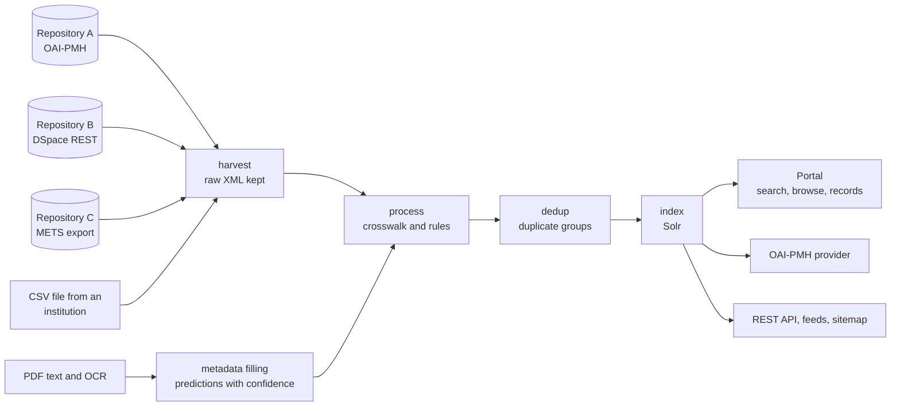

# 1. Introduction and functional overview

## What an ETD aggregator does

Universities keep their theses in institutional repositories (usually DSpace). Each repository is searchable on its own, but a reader, a supervisor or a national regulator wants to see the country's research output in one place. An **ETD aggregator** collects the metadata (title, author, supervisor, degree, faculty, department, year, abstract, link to the full text) from every repository, makes it consistent, and offers it back:

- to people, through a search portal with facets, browsing and record pages;
- to programs, through an OAI-PMH data provider (so that international services such as NDLTD can harvest the whole country at once) and a REST API;
- to the institutions and the regulator, through metadata quality figures, usage figures and reports.

The aggregator does not store theses or accept deposits. Full texts stay in the institutions' repositories; the portal links to them.

## What NETD adds to plain harvesting

Repository metadata is uneven. In the Zambian collection, supervisor and department were empty in every repository's metadata, degree names were written in dozens of ways, and some collections held undergraduate work. NETD therefore:

- keeps the **raw harvested record untouched** and rebuilds the cleaned record from it whenever the rules change;
- records the **origin of every value** (harvested, derived from the repository's collection structure, derived by a rule, predicted by a model, corrected by a person), and shows derived values as such;
- **fills missing values from the PDF** (title page, approval page, acknowledgements), with OCR for scanned theses, and only shows predictions above a confidence threshold;
- assigns a **standard field of study** (OpenAlex Topics) to every thesis;
- finds **duplicate copies** of a thesis and lists them under one main record;
- merges **spelling variants** of department and supervisor names for display, keeping the original spellings;
- keeps the collection to **postgraduate work** (Master's, Doctoral, Postgraduate Diploma) by rule, model and hand decision.

## Data flow

1. **Harvest.** Each source in `harvester/sources.yml` is harvested with OAI-PMH (preferring DSpace's `dim` format, then `etdms`, then `oai_dc`), or with a fallback loader: DSpace 7 REST API, DSpace 6 METS exports, or a CSV file for institutions without a working repository. Runs are incremental after the first; the XML is stored as received.
2. **Process.** The crosswalk maps each raw record to the canonical record (ETD-MS elements), derives faculty and department from the repository's collections where they are named that way, applies cleaning rules (whitespace, capitalisation, person names, degree names and levels), and applies postgraduate scope and exclusions.
3. **Metadata filling.** PDF text is extracted (OCR for scanned PDFs) and cached; models predict missing fields with a confidence; predictions at or above the threshold are laid over the canonical record, marked as derived. Hand corrections take precedence over everything.
4. **Deduplicate.** Theses deposited twice (or in two repositories) are grouped.
5. **Index.** Canonical records become Solr documents; department and supervisor variants are merged at this stage.
6. **Serve.** The Blacklight portal, the OAI-PMH provider, the REST API, feeds and the sitemap all read Solr. The admin panel reads the staging store and the portal database as well.

The whole cycle runs nightly. A full rebuild of the index from the stored records takes a few minutes.

## Main parts

| Part | Technology | Where |
|---|---|---|
| Harvester and processing pipeline | Python 3.12 (`netd` package) | `harvester/` |
| Staging store (raw and canonical records, predictions, corrections) | SQLite in WAL mode | `harvester/netd.sqlite3` |
| Search index | Apache Solr 9 | `solr/netd/conf` |
| Portal, admin panel, OAI-PMH provider, REST API | Ruby on Rails 8 with Blacklight 9 | `portal/` |
| Scheduling, alerts, backups | systemd timers, shell and Python scripts | `deploy/` |

See [chapter 11](11-architecture.md) for the design.
