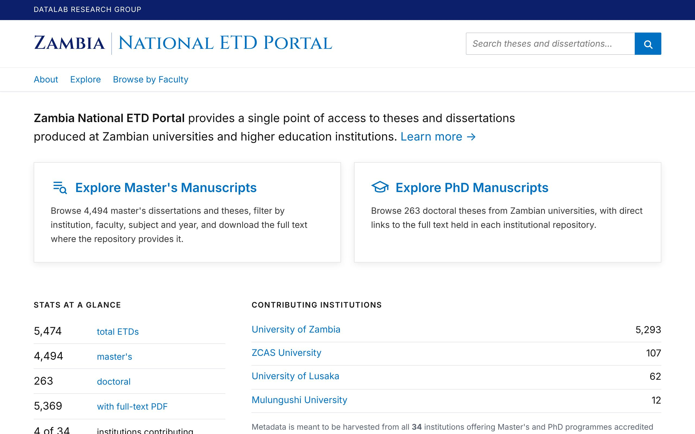
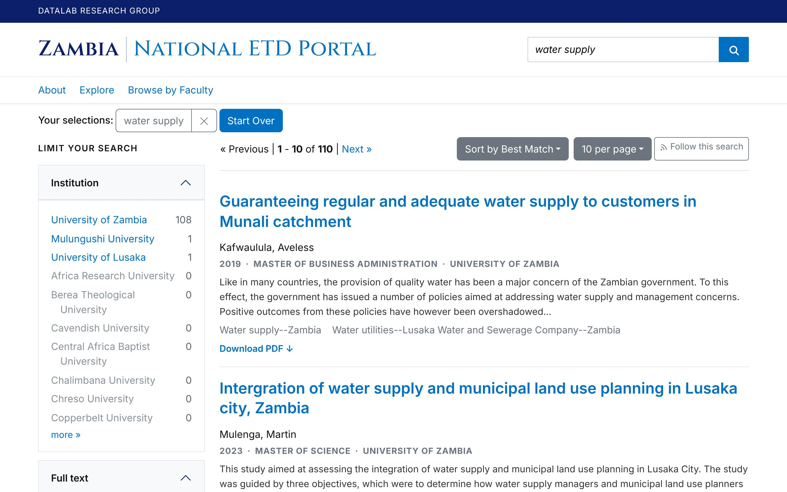
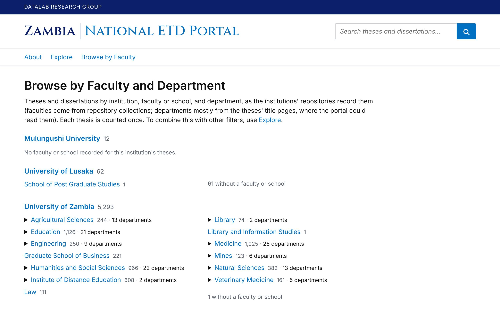
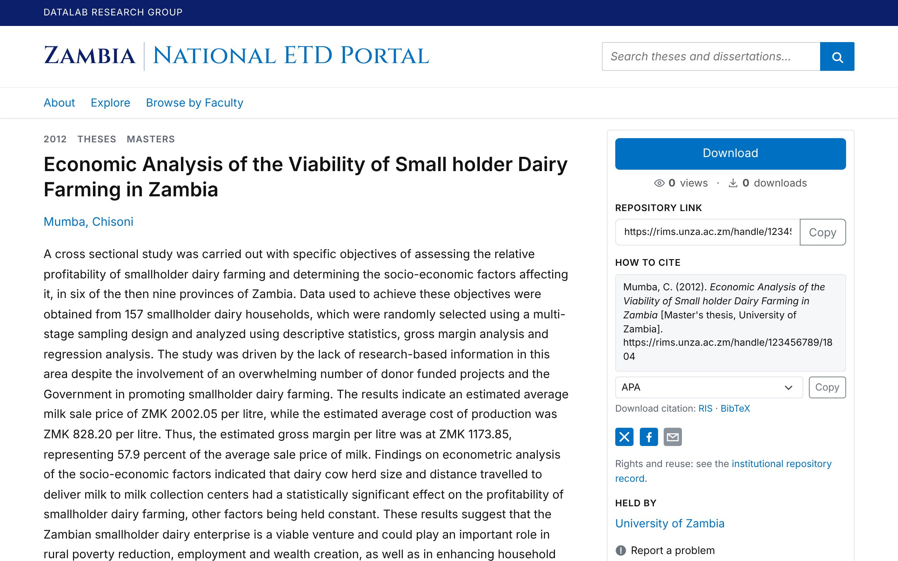
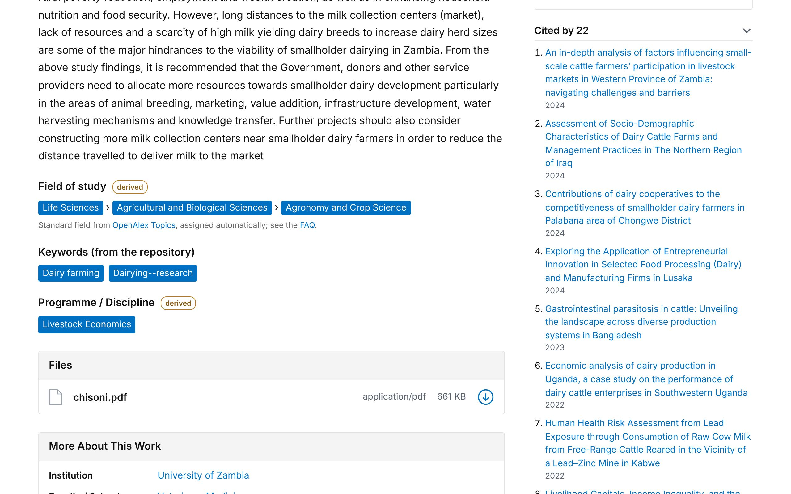
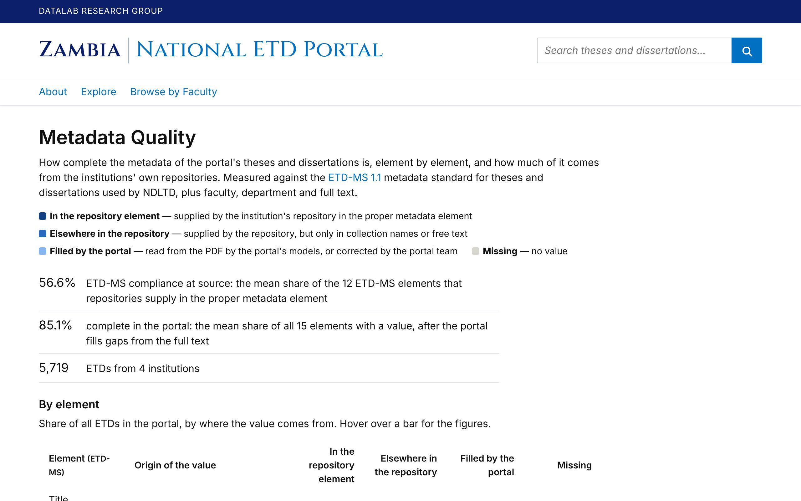

# 5. Using the portal

This chapter is for readers, librarians and anyone helping others use the portal. Screenshots are from the Zambian installation (November 4, 2026).

## 5.1 Home page

The home page has the search box, links to explore Master's and PhD theses, figures "at a glance" (theses, institutions, years covered), and the list of contributing institutions. Institutions expected to contribute but not yet harvested are listed behind a toggle with 0 records.

## 5.2 Searching

Type words in the search box and press Enter. The menu next to the box limits the search to **Title**, **Author**, **Supervisor** or **Subject**; the default is **All fields** (title, authors, supervisors, abstract, keywords, degree, faculty, department, field of study). Searching ignores accents and capitals. Quotation marks search for a phrase (`"water supply"`).

Each result shows the title, the authors, a line with **year · degree · institution**, up to three lines of the abstract, and the keywords (or, when the repository gave none, the portal's field of study in italics). A **Download PDF** link appears when the repository gives a direct link to the full text, and **Cited by N** when works in OpenAlex cite the thesis (it leads to the record page's Cited by section).

- **Sort by:** Best Match, Published Latest, Published Earliest, Title A-Z, Title Z-A, Newest Additions, Most Cited (most citing works in OpenAlex first).
- **Show:** 10, 20, 50 or 100 results per page.
- **Duplicates:** a thesis deposited more than once is listed once, under its main record.

## 5.3 Facets (filters)

The left-hand column narrows the results. Choose a value to filter; choose it again (or the × in the filter bar) to remove it. Several facets can be combined.

| Facet | What it holds |
|---|---|
| Institution | contributing institutions (top 10, "more" for the rest) |
| Full text | whether a direct full-text link exists |
| Citations (OpenAlex) | **Cited**: only theses cited by at least one work in OpenAlex |
| Degree level | Masters, Doctoral, Postgraduate Diploma |
| Research domain, Field of study, Subfield | the standard OpenAlex Topics classification assigned by the portal to every thesis |
| Faculty / School, Department | from the repository's collections or the title page; spelling variants merged |
| Programme / Discipline, Degree | from the degree statement |
| Supervisor | from the repository or the thesis itself; spelling variants of one person merged |
| Keywords (from the repository) | the repository's own subject terms |
| Year | newest years first |

Values the portal derived (from the collection structure, by a rule, or by a model reading the PDF) are only used in facets when their confidence is high enough; see [chapter 9](09-metadata-filling.md).

## 5.4 Browsing

**Browse** in the header lists institutions, their faculties or schools, and their departments, with the number of theses in each. Each count opens the matching search.

## 5.5 Record pages

A record page has the address `/theses/<short id>` (for example `/theses/unza-6330`); older `/catalog/<id>` addresses redirect to it. It shows:

- title, authors, abstract, degree, institution, faculty, department, supervisors, year, keywords and field of study;
- **Download PDF** and **Repository link** (the item on the institution's repository), and view and download counts;
- values the portal filled in itself, marked as derived, with their origin;
- other copies of the same thesis, if any;
- **Cited by**: works in OpenAlex that cite the thesis, with their year, when there are any (in the right-hand column, which can be collapsed; matched weekly; most theses have none);
- **How to cite** (below), **Similar theses** (five theses with similar titles and abstracts, a section that can be collapsed), a Google Scholar link, and **Report a problem** (a short form; reports go to the portal team).

## 5.6 How to cite

On each record page, **How to cite** shows a citation in one of ten styles (APA by default; also Chicago author-date, Harvard, IEEE, MLA, Vancouver, Turabian, ACM, American Chemical Society and ABNT). **Copy** puts it on the clipboard; **RIS** and **BibTeX** download it for reference managers (Zotero, Mendeley, EndNote, JabRef). Titles written in capitals in the repository are put into sentence case. The link cited is the item on the institution's repository.

## 5.7 Following new additions

Any search can be followed: **Follow this search** (next to the result count) gives an **Atom** and an **RSS** feed of the theses newly added to the portal that match the search and filters. Paste the feed address into a feed reader. The sort **Newest Additions** shows the same order on the page.

## 5.8 Metadata quality

The public **Metadata quality** page shows, for the whole collection, how complete each element is and where the values come from (the repositories or the portal), against the ETD-MS 1.1 metadata standard.

## 5.9 For programs

- **REST API** (`/api/v1`): search, single records, institutions, statistics and bulk export (CSV, JSON Lines), with an interactive reference at `/developers/api`.
- **OAI-PMH** (`/oai`): for harvesters such as NDLTD; Dublin Core and ETD-MS.

Both are described in [chapter 10](10-interfaces.md). The **Developer Resources** page on the portal links to them, and **For Institutions** explains how an institution's theses get into the portal.
