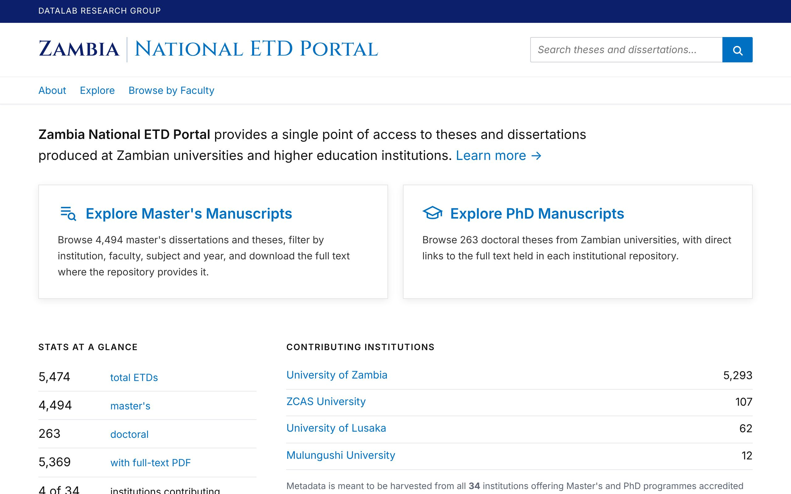
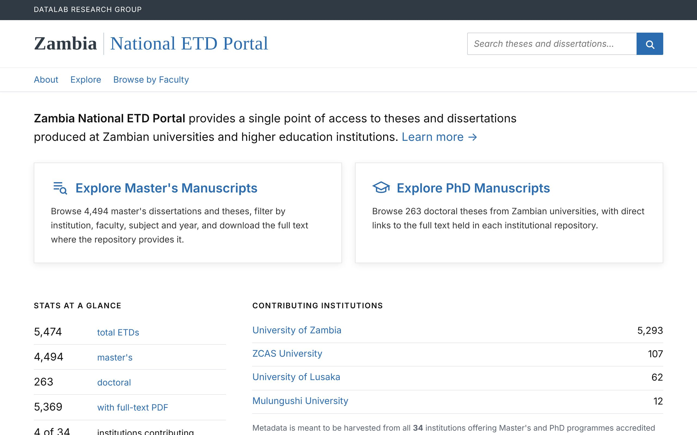
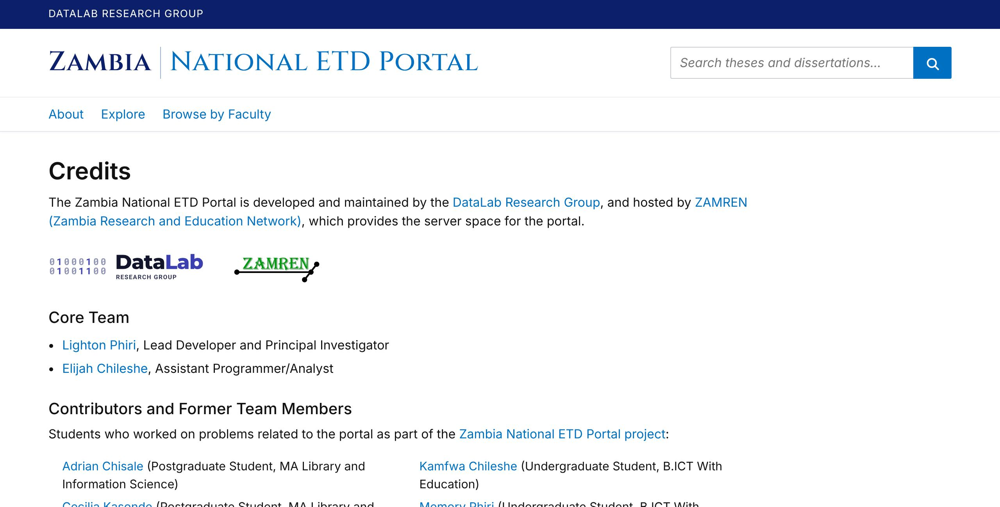
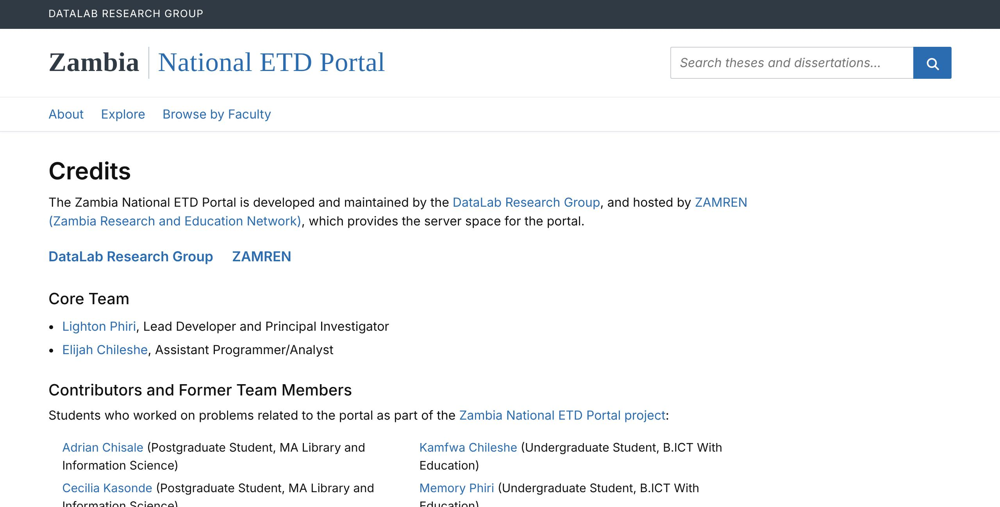

# 8. Customisation

How to make a NETD installation your own: its name, look, pages, language and citation styles. Start with `config/country.yml` ([chapter 7.1](07-configuration.md)): it sets the host name, contact and sender addresses, the portal name used in e-mail and reports, and the time zone. The rest of this chapter is still edits to templates and styles; the packaging plan moves them into the same file, locale files and a theme folder, release by release.

Keep your changes on a branch of your own (or in a fork) so that upgrades can be merged; after any change below, run `deploy/deploy.sh`.

## 8.1 Name

| Where it appears | File |
|---|---|
| Browser titles and Blacklight's own labels, OAI-PMH `Identify` repository name, RIS exports | `portal.name` in `config/country.yml` |
| Header wordmark (two parts, e.g. "Zambia" and "National ETD Portal") | `portal.wordmark` in `config/country.yml` |
| Footer credit line, header group bar | `credits` in `config/country.yml` (sentence built in `portal/app/views/shared/_footer.html.erb`) |
| Home page introduction | `portal.name`, `country.adjective` and `regulator` in `config/country.yml`; the rest of the text in `portal/app/views/catalog/_home_text.html.erb` |
| Emails (problem reports, alerts), Excel and PDF reports, OAI-PMH administrator e-mail | `portal.name`, `portal.host`, `contact.email` in `config/country.yml` |
| REST API specification | `portal.name`, `portal.host`, `country.adjective`, `regulator.name`, `contact.email` and the `developed by` credit in `config/country.yml`; the rest in `portal/app/views/static_files/openapi.text.erb` |

## 8.2 Logo and credits

Credits are listed in `credits` in `config/country.yml` ([chapter 7.1](07-configuration.md)): the header bar and footer name the entry with role `developed by`, and the About and Credits pages show every entry's logo, in order; an entry without `logo`, or whose file is not found, is shown by its name instead (and the footer then shows no logo). Put the logo files in your theme's `public/images/` folder (section 8.3; for example `themes/zambia/public/images/`) and name them in `logo` (with `logo_height` in pixels); they are served at `/images/<file>`. `class` is the style class of the logo link (`datalab-credit` and `zamren-credit` are styled in `netd.css`). The site icons are part of the theme as well (section 8.3).

## 8.3 Colours and fonts

Colours, the wordmark font and the logo files form a theme: a folder `themes/<name>/` named by `portal.theme` in `config/country.yml` ([chapter 7.1](07-configuration.md)). Two are shipped: `zambia` (navy and blue, Cinzel wordmark, the DataLab and ZAMREN logos) and `default` (neutral slate and blue, the system serif font, a neutral book icon, no logos), used when `portal.theme` is not set. To make your own, copy `themes/default` to `themes/<name>`, edit it and set `portal.theme: <name>`; then run `deploy/deploy.sh` (it rebuilds the style sheets) or restart the portal.

```text
themes/<name>/
  stylesheets/theme.css    colours and fonts (below)
  public/images/           logo files named in credits; served at /images/<file>
  public/icon.png          site icon, 512 x 512 pixels (home-screen and app icon)
  public/icon.svg          the same icon as SVG
  public/favicon.svg       optional browser-tab icon (or favicon.ico); without it the pages use Blacklight's
```

The two shipped themes, on the home page and the Credits page. `default` is shown with the Zambian credits, whose logo files it does not have, so the Credits page names them instead:

| `zambia` | `default` |
|---|---|
|  |  |
|  |  |

`theme.css` sets CSS variables that `portal/app/assets/stylesheets/netd.css` (the layout) reads:

```css
:root {
  --netd-navy: #2f3a45;           /* group bar, first wordmark part */
  --netd-blue: #2b6cb0;           /* links, buttons, second wordmark part */
  --netd-blue-dark: #22558a;      /* hover */
  --netd-blue-pale: #eef3f9;      /* menu hover background */
  --netd-wordmark-rule: #b5c3d1;  /* line between the wordmark parts */
  --netd-wordmark-font: Georgia, "Times New Roman", serif;
  --netd-muted: #5b6470;          /* secondary text */
  --netd-line: #e3e6ea;           /* rules and borders */
  --bs-primary: #2b6cb0;          /* Bootstrap's own variables repeat the blue */
  --bs-primary-rgb: 43, 108, 176;
}
```

Change the variables rather than individual rules; the `-rgb` triplets must match the colour above them. A web font is loaded with an `@import` at the top of `theme.css` (the `zambia` theme loads Cinzel). `theme.css` is read after `netd.css`, so it may also override a rule. Check contrast for text on the header colour (at least 4.5:1).

## 8.4 Static pages

| Page | Template |
|---|---|
| About (project, team, publications) | `portal/app/views/pages/about.html.erb` and `portal/config/publications.yml` |
| FAQ | `pages/faq.html.erb` |
| Developer Resources | `pages/developers.html.erb`; API reference `pages/api_docs.html.erb` |
| For Institutions (how to contribute) | `pages/contribute.html.erb` |
| Credits | `pages/credits.html.erb` |
| Metadata quality (public) | `portal/app/views/quality/index.html.erb` |

The templates hold the layout; the wording of these pages (except the quality page) is in `portal/config/locales/en.yml` under `netd.about`, `netd.faq`, `netd.developers`, `netd.api_docs`, `netd.contribute` and `netd.credits` (section 8.6). To add a question to the FAQ, add an `<h2>` and a `<p>` to the template, each with an `nt(...)` call, and their two keys to `en.yml`.

The FAQ describes what is counted in usage analytics and how long server logs are kept (`netd.faq.no_the_portal_uses_html`); update it to match your server and your country's data protection law.

## 8.5 Facets, fields and sorting

Facets, search fields, sort options and results per page are set in `portal/app/controllers/catalog_controller.rb` (`add_facet_field`, `add_search_field`, `add_sort_field`). Search field weights are in `solr/netd/conf/solrconfig.xml`. A new facet needs a Solr field written by `harvester/netd/index.py`.

## 8.6 Languages

The interface is in English. Its wording is being moved out of the templates into `portal/config/locales/en.yml`, a few pages per release: the header, footer, home page, the static pages (About, Credits, FAQ, For Institutions, Developer Resources, REST API reference), Browse by Faculty, Follow a search, Metadata Quality, the record page (`netd.record`, including the Report a problem form) and the search result cards (`netd.results`) are there now, under `netd.header`, `netd.footer`, `netd.home`, `netd.about` and so on; the institution statuses (`netd.institution_status`) and the quality groups (`netd.quality_groups`) too; the admin navigation, the sign-in, password, activity log, level review, problem report and CSV upload pages (`netd.admin`) and the mail sent to the team for a problem report (`netd.mail.problem`, plain text: keep the spaces that line up its labels) as well; the remaining admin pages (dashboard, source, record correction, duplicates, quality, usage, the report forms), the kinds of use counted (`netd.usage_events`) and the messages shown after an action (`netd.flash`) too, so every page's own text is in this file. What stays in the code: the contents of the reports for the regulator (titles, headings and notes of the Excel, PDF and preview tables), the problem types offered by the Report a problem form (they are stored with each report, so changing them needs a data migration), validation messages from the models, and the field names on the record correction page. In development and test a missing key raises an error (`config.i18n.raise_on_missing_translations`), so a typing error in a key shows at once; in production a key missing from a translation falls back to English. The names of the facets, of the fields in a search, and of the sort options are Blacklight's own keys, below the `netd:` block in the same file: `blacklight.search.fields.facet.<field>`, `...search.<field>` and `...sort.<option>` (for example `blacklight.search.fields.facet.institution_ssim: "Institution"`). Dates use the formats `time.formats.netd` and `date.formats.netd` ("November 5, 2026"); a translation with Rails' month names for its language (the `rails-i18n` gem, or `date.month_names` in its own file) prints them in that language. Each heading, paragraph, list item and table cell is one key, named after its first words; `page_title` is the browser tab title and `heading_html` the page heading. Blacklight's own texts (search form, pagination, facet buttons) come from the Blacklight gem, and the portal name from `config/country.yml` through `portal/config/locales/netd_country.rb`.

To change a sentence, edit its key in `en.yml` and restart the portal (`sudo systemctl restart netd-portal`). Names come from `config/country.yml`: write `%{portal}`, `%{country}`, `%{country_adjective}`, `%{regulator}`, `%{regulator_short}`, `%{email}`, `%{host}` or `%{base_url}` rather than the name or address itself, so the text stays right for another installation. A count with singular and plural forms has `one:` and `other:` below its key (for example `netd.browse.departments`); languages with more plural forms add them the same way. Keys ending in `_html` may contain HTML (write `&` as `&amp;`); the comments in the file say which keys take extra values such as `%{n}` or `%{link}`.

To add a language, copy `en.yml` to, for example, `fr.yml`, change the first line to `fr:` and translate the values (keep the keys and the `%{...}` names), translate Blacklight's texts the same way (`blacklight.fr.yml`, from the gem's own file), and set the locale in `portal/config/application.rb` (`config.i18n.default_locale = :fr`). Metadata is shown in the language it was deposited in.

## 8.7 Citation styles

"How to cite" uses official Citation Style Language files in `portal/config/csl/`, rendered by `citeproc-ruby`; terms come from `locales-en-GB.xml`. To add a style, copy an independent `.csl` file from https://github.com/citation-style-language/styles into that folder and add a line to `Citation::STYLES` in `portal/app/models/citation.rb` (key, label, file name). To change the default, set `Citation::DEFAULT`. For another language's terms, add its locale file from https://github.com/citation-style-language/locales.

Titles written in capitals are put into sentence case; words that must keep their capital letter are a general list (`KEEP_GENERAL` in `citation.rb`: continents, directions, diseases, international bodies, Roman numerals) plus `citation.keep_capitals` in `config/country.yml`. Add your country's place names, institutions and bodies there.

## 8.8 Time zone and dates

Dates are written as "January 3, 2027". Admin panel and quality-page times are shown in `country.time_zone` from `config/country.yml` (labelled with its city, e.g. "Lusaka time"); stored and API times are UTC; systemd timers run in the server's time zone.
