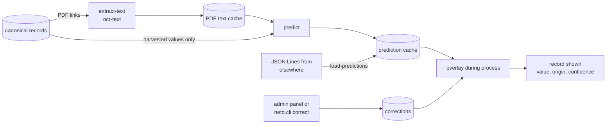

# 9. Metadata filling

Repository metadata is often missing the fields readers and regulators want most: supervisor, department, faculty, degree and level. NETD fills them from the theses themselves, marks every filled value as derived, and only shows values its models are confident about. A runnable, step-by-step explanation is in `notebooks/netd26-03-ml_metadata_filling-walkthrough.ipynb`.

## 9.1 How it works



1. **Text cache.** `extract-text` downloads each record's front-matter PDFs (title page and similar first, at most three files, at most 60 MB each) and keeps the text of the first 8 pages. PDFs without a text layer are OCRed by `ocr-text` (Tesseract, first 5 pages, about 20 seconds each, at low priority).
2. **Predictions.** `predict` runs every model over the PDF text and the record's **harvested** values (never other models' output, so results do not feed back on themselves). A model runs again for a record only when its input or its version changes. Each prediction has values, a confidence and evidence (the text it came from).
3. **Overlay.** During `process`, an empty field takes the best prediction whose confidence reaches the threshold (`ml.show_threshold`, 0.8). The value is marked `model:<name>-<version>` with its confidence, shown as derived on the record page and in the API. A hand correction always wins.
4. **Scope.** A model's prediction that a record is below postgraduate level excludes it at confidence 0.95 or more (`ml.level_auto_exclude`), or queues it for review between 0.6 and 0.95.

The nightly run does steps 1 and 2 for new or changed records (limits in `enrichers.yml`), so new theses get derived values the same night.

## 9.2 Models included

| Model | Fields | Method |
|---|---|---|
| `titlepage-rules` (v11) | degree, discipline, degree level, faculty, department, supervisors | rules over title-page, approval-page and acknowledgement text: degree statements ("in partial fulfilment of the requirements for the degree of …"), unit lines, supervisor statements in many forms, name clean-up |
| `openalex-fos` | research domain, field of study, subfield (OpenAlex Topics) | title and abstract → MiniLM sentence embedding (fastembed, CPU) → logistic regression over 252 OpenAlex subfields, backing off to field or domain when uncertain |

**Limits.** `titlepage-rules` was developed and tuned on title pages from the University of Zambia and checked on three other Zambian institutions. Other institutions' title pages, other languages and other degree wording will need new rules or a new model; measure before trusting it (9.4). The words it treats as never being names include Zambian institution abbreviations (`NOT_NAMES` in `titlepage.py`). OCR quality limits what can be read from older scanned theses.

## 9.3 Thresholds

Set in `harvester/enrichers.yml` under `ml` (see [chapter 7](07-configuration.md)). Raising `show_threshold` shows fewer, more reliable values; lowering it fills more fields with more errors. After changing a threshold, run `reprocess`; predictions do not need to be recomputed.

## 9.4 Evaluating with a gold standard

Never change a threshold or a model without measuring it on hand-checked records.

1. `gold-sample /opt/netd/logs/gold.csv --n 300` writes a sample stratified by institution (duplicate copies left out) with harvested values, empty `gold_*` columns, and a dev/test half for each record.
2. Annotators fill the `gold_*` columns from the PDFs (several values separated by `||`; `-` when the thesis does not say).
3. `evaluate gold.csv` prints coverage, precision, recall and F1 per model, version and field at thresholds 0, 0.8 and 0.95; `--strata` splits the figures by kind of PDF text (born-digital, scanned and OCRed, scanned and waiting, no text).
4. **Tune on the dev half only**; report the test half. People are matched by surname with compatible initials.

## 9.5 Running a backlog

For a first installation, or after a repository outage, run text extraction and OCR as a transient unit in batches under the harvest lock, so the nightly run waits at most one batch:

```bash
sudo systemd-run --unit=netd-mltext --uid=netd --gid=netd --working-directory=/opt/netd/harvester --nice=10 \
  /bin/bash -c 'for i in $(seq 1 15); do flock -w 7200 run.lock .venv/bin/python -m netd.cli extract-text --limit 500 || exit 1; done;
                for i in $(seq 1 80); do flock -w 7200 run.lock .venv/bin/python -m netd.cli ocr-text --limit 50 || exit 1; done'
journalctl -u netd-mltext -f
```

Then predict and apply safely: `sudo systemd-run --unit=netd-mlapply --uid=netd --gid=netd /opt/netd/deploy/ops/netd-ml-apply.sh` runs `predict`, a dry run on a copy of the store, and `reprocess` only if the dry run would exclude at most 10 new records on a model's say. `deploy/ops/ocr-resume.sh` keeps OCRing while a repository answers and waits while it does not.

## 9.6 Adding a model

A model is a Python module with:

```python
NAME = "my-model"           # used in provenance: model:my-model-<VERSION>
VERSION = "1"               # change it whenever the output can change
FIELDS = ["supervisor"]     # fields it predicts
USES = ["title", "degree"]  # harvested fields it reads

def predict(record, text):
    """record: harvested values of USES; text: cached PDF text (pages).
    Returns {field: (values, confidence, evidence)}."""
    return {"supervisor": (["Jane Banda"], 0.9, "Supervisor: Prof. Jane Banda")}
```

Register it in `MODELS` in `harvester/netd/ml/predict.py`, then `predict --model my-model`, evaluate on the gold standard, and `reprocess` when the figures are acceptable. Predictions made elsewhere (a notebook with a GPU, an external service) can be loaded instead: JSON Lines with `record_id, field, model, version, value, confidence` (optional `evidence`, `input_hash`), then `load-predictions FILE.jsonl` and `reprocess`.

Simpler clean-ups that need no PDF text can be **enrichers**: a function `enrich(record) -> record` registered in `enrichers.yml` as `package.module:function`, which sets `record["provenance"][field]` and optionally `record["confidence"][field]` for every value it changes.

## 9.7 Name variants (display only)

At indexing time, spelling variants of **department** names (`harvester/netd/units.py`) and of **supervisor** names (`harvester/netd/people.py`) are merged per institution. The store and the predictions are not changed; the original spellings remain searchable and are shown on the record page. Supervisor spellings join only when the surname matches and the initials agree; bare surnames never join. Department merges by edit distance are tuned with `FUZZY_RATIO` and `FUZZY_MAX` in `units.py`.
