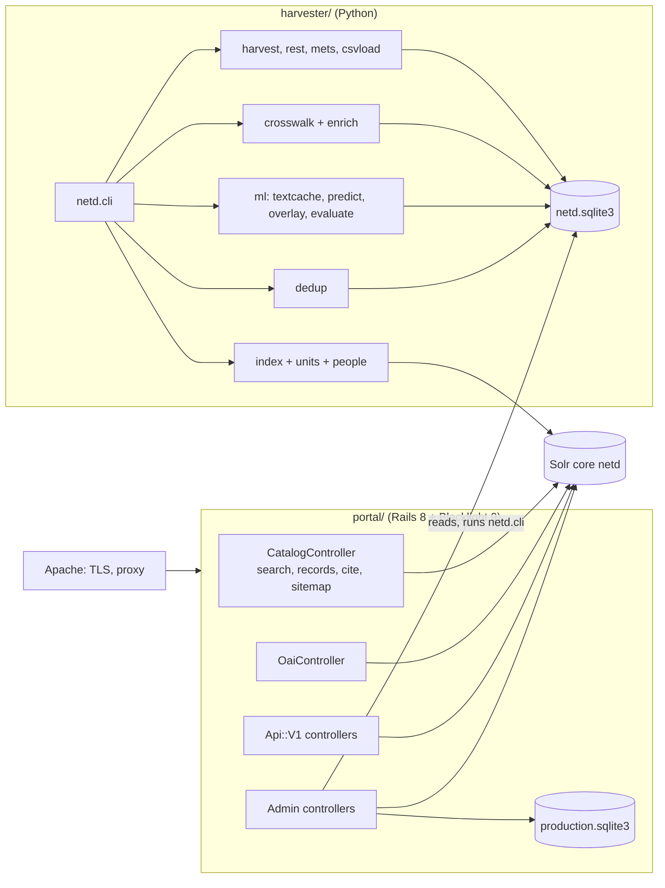

# 11. Architecture and directory layout

This chapter summarises the design. The full design, with UML views and the rationale for each decision, is `docs/SDD.md` (IEEE 1016); the requirements are `docs/SRS.md` (ISO/IEC/IEEE 29148).

## 11.1 Components

| Component | Responsibility |
|---|---|
| `netd.harvest` | OAI-PMH client (Sickle): format choice, sets, incremental runs, retries, run log; second pass for PDF links (`ore`) |
| `netd.rest`, `netd.mets`, `netd.csvload` | fallback loaders: DSpace 7 REST, DSpace 6 METS exports, CSV files; all write DSpace `dim` XML to the raw layer |
| `netd.store` | SQLite store: raw layer (XML as received), canonical layer, harvest runs, set names, predictions, corrections, duplicates |
| `netd.crosswalk` | `dim`/`etdms`/`oai_dc` → canonical record; units from collections; record links; provenance |
| `netd.enrich` | built-in cleaning rules and plug-in enrichers |
| `netd.ml` | PDF text cache and OCR, models, prediction cache, overlay, evaluation |
| `netd.dedup` | duplicate groups and main records |
| `netd.index`, `netd.units`, `netd.people` | Solr documents; department and supervisor variants merged for display |
| `netd.quality`, `netd.repocheck` | metadata quality figures; weekly check of repositories not yet harvested |
| Portal | Blacklight search and record pages, browse, citations, feeds, sitemap, OAI-PMH provider, REST API, admin panel, reports, usage counting |

## 11.2 Data

- **Staging store** `harvester/netd.sqlite3` (SQLite, WAL mode): the system of record. The raw layer is never changed by processing, so the canonical layer can always be rebuilt (`reprocess`).
- **Canonical record**: ETD-MS-shaped fields (title, authors, supervisors, degree, discipline, level, grantor, faculty, department, date, abstract, subjects, links, files), each value with its **provenance** (`harvested`, `set:<spec>`, `rule:<name>`, `text:<rule>`, `model:<name>-<version>`, `corrected:<by>`) and, for derived values, a **confidence**.
- **Search index**: Solr core `netd` with Blacklight's dynamic-field naming (`*_ssim`, `*_tsim`, `*_isi`, `*_dtsi`); rebuilt from the store in minutes, so not backed up.
- **Portal database** `portal/storage/production.sqlite3`: accounts and sessions, activity log, problem reports, usage counts (aggregate only), search history (one day).

## 11.3 Deployment

One server, no containers: Apache (TLS, reverse proxy) → Puma (127.0.0.1:3010) → Solr (127.0.0.1:8983). All NETD services run as the unprivileged user `netd` under `/opt/netd`, managed by systemd units with failure alerts. Python comes from uv, Ruby is compiled once, Solr is the upstream distribution, so the operating system's own packages are hardly touched (the design suits a shared server with 4 GB of memory). The choice of a custom pipeline with Blacklight over InvenioRDM, VuFind or DSpace-as-aggregator, of SQLite over PostgreSQL, and of native services over Docker, is explained in SDD section 9.

## 11.4 Directory layout

| Path | Contents |
|---|---|
| `harvester/netd/` | the Python package (modules above); `ml/models/` the models and their data |
| `harvester/sources.yml`, `institutions.yml`, `enrichers.yml` | configuration ([chapter 7](07-configuration.md)) |
| `harvester/tools/` | training scripts for the fields-of-study model |
| `portal/app/controllers/` | catalog, browse, follow, pages, quality, OAI, problem reports; `api/v1/`; `admin/` |
| `portal/app/components/` | header, result card, record page, facet components |
| `portal/app/models/` | `Citation`, `ApiRecord`, `InstitutionRegistry`, `Harvester`, `QualityReport`, `GeoLookup`, `User`, usage models |
| `portal/app/reports/` | report definitions (`hea_report.rb`) and the Excel and PDF renderers |
| `portal/app/views/` | templates (pages, catalog, admin, mailers) |
| `portal/config/` | Blacklight, routes, locales, citation styles (`csl/`), publications |
| `portal/public/` | static files: API specification, CSV template, images, `robots.txt` |
| `solr/netd/conf/` | Solr configset |
| `deploy/` | `install-server.sh`, `deploy.sh`, `apache/`, `systemd/`, `ops/` (backup, alert, probe, users, ML apply, OCR resume, GeoIP update, `upgrade/`) |
| `tests/` | OAI-PMH and REST API conformance tests; unit tests |
| `notebooks/` | metadata-filling walkthrough |
| `docs/` | SRS, SDD, this manual, the Zambian operations runbook, plans and backlog |
